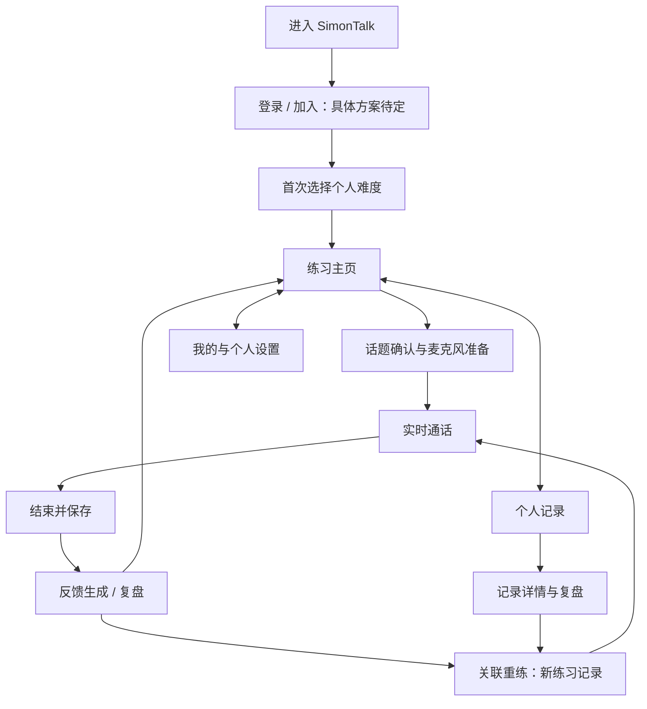

# SimonTalk 页面与交互规格

日期：2026-10-15。本文定义页面与交互规格，具体决策状态见第 1 节；实现与验证进度统一见根目录 [HANDOFF.md](../../HANDOFF.md)。

本文件依据[首版产品设计](../superpowers/specs/2026-10-15-simontalk-mvp-design.md)与[产品及技术调研](../research/2026-10-15-product-and-stack-review.md)，把一次个人练习从进入、开口、结束到复盘和重练的行为写清楚。它定义用户应能理解和控制的行为，不代表技术路线已通过验证。技术质量与实际设备验证统一见[验证计划](../validation/2026-10-15-validation-plan.md)。

颜色、字体、间距、组件、伙伴动效及响应式参数统一见[视觉设计规范](2026-10-15-visual-design-spec.md)。本文维护操作语义，视觉规范细化呈现；新增视觉默认仍为建议，不改变用户确认的功能范围。

## 1. 决策状态与范围

| 状态 | 内容 |
| --- | --- |
| 用户已确认 | 在中国大陆，由本人和几位朋友使用；Flutter 覆盖 iOS、Android、Web；首期练英语日常交流；实时自动接话，允许自然插话；每人独立难度；会后集中反馈；整体采用 A 方向“轻量语音伙伴” |
| 本文设计建议，待评审 | 难度先分为基础 / 进阶 / 熟练；“练习 / 记录 / 我的”三个一级入口；浅色、留白与单一强调色；森林绿作为候选强调色；约五分钟作为轻量练习建议而非强制结束时间；以下按钮文案、默认显示偏好、删除与后台暂停细则 |
| 尚未确定 | 具体登录与账号恢复方式；是否采用邀请码；伙伴名称及最终形象；视觉规范候选色值与字体的最终采用；正式语音供应商、型号及恢复能力；是否保存原始录音 |

账号的目的为隔离各人的设置、历史与反馈。本文件将“登录 / 加入”作为入口能力，不把用户名密码、短信、第三方登录或邀请码写成用户已选定方案。认证方案确定后补充相应字段和恢复流程。

若采纳用户名密码方案，首版“忘记密码”建议进入“联系维护者”：由维护者线下核实身份，提供单次重设凭证，再由用户自行设置新密码。该凭证不得成为查看私人历史的入口，也不由维护者代设或接收新密码。此方案不暗示短信验证码或自动邮件找回服务已经具备。

“几位朋友使用”指各自进行一对一 AI 练习。首版没有多人同场通话、好友动态、排行榜或向朋友共享私人对话。个人难度不由其他人的表现决定。

本文把新提出的交互规则当作可评审建议；只有上表第一行属于用户确认的范围。质量、延迟、重连时间等数值统一由验证文档规定，本文件不承诺尚未测得的阈值。

## 2. 信息架构与跨页规则



窄屏使用底部“练习 / 记录 / 我的”；通话、结束保存和复盘是完整页面，不保留底栏，避免误触切走。宽屏可以把同样的一级入口放入侧栏，不增加一套新的流程。

同一账号同时只有一场正在进行的练习；再次点开始、重复点击或在另一设备打开时，先显示已有练习状态，提供“回到练习”或“结束已有练习后开始”。不静默创建两场通话。后台生成反馈不算占用通话，可在旧反馈生成时开始下一次练习。

页面返回应回到实际入口：从记录进入的复盘返回记录，从刚结束的练习进入复盘则返回练习主页。重练返回原复盘时保留滚动位置。浏览器前进后退和 App 返回手势遵守相同规则。

## 3. 通用呈现约定

- 主操作只保留一个清楚的视觉重点；危险操作写出影响，不只写“确定”。文中引号内文案均为建议稿。
- 连接、听取、思考、播报和中断用文字与动效共同表达，不让用户仅凭颜色或声波猜状态。
- 练习中不显示实时语法红线、错误计数或发音分数。用户主动求助时可以得到表达辅助；系统性的纠错留到会后。
- 最终转写与临时识别字幕区分。尚未稳定的字幕使用“识别中”表现，改写后不把旧片段重复留在历史。
- 历史保留当时的话题、难度和辅助设置快照；修改个人难度不改写过去的记录。当前通话内的字幕、中文提示、翻译和静音开关立即生效，显示变化不改变本场难度快照；个人默认难度影响下一场练习。
- 对话文本和反馈只属于当前账号。截图、导出和分享不作为首版页面操作。

## 4. 首次使用与练习前准备

首次进入顺序为：理解用途 → 登录 / 加入 → 选择难度 → 练习主页。用途说明用一屏短文表达“和 AI 聊日常英语，结束后一起复盘”。兴趣可跳过，避免开口前填写长问卷。

难度选择必须由本人明确选择，提供可读的能力描述，不冒充正式水平测评：

| 难度 | 建议说明 | 对体验的影响 |
| --- | --- | --- |
| 基础 | “能说简单词句，希望多等我一会儿” | 常见词、短问题、较慢的目标语速、更多组织句子的空间；按需给中文意思和英文开头 |
| 进阶 | “能聊熟悉的话题，想把话说完整” | 适度追问、完整表达、必要时提供英文表达辅助 |
| 熟练 | “能连续交流，想聊得更自然” | 自然语速与细节追问、理由和观点表达；仍允许停顿和主动求助 |

这三个档位没有未经验证的 CEFR 对应，也不锁定用户。说明下方提示“随时可以调整”，首次选择后到主页。

麦克风权限在用户首次点“开始聊天”时请求，而非进入应用就弹系统框。请求前说明用于本次语音练习。浏览器还需确认安全访问环境、可用输入/输出设备与声音播放能力；申请权限本身不代表练习已开始。用户点开始后的设备准备可能打开本地麦克风，系统可出现麦克风使用标识；在媒体及模型就绪前，不向模型上送音轨，也不显示“正在听你说”。优先在需要时才采集，具体平台行为需验证，不能保证所有平台授权时都完全不启用本地采集。

准备页或轻量面板包含所选话题、难度、“开始语音练习”及返回入口。麦克风状态可为未请求、可用、被拒绝、设备不可用。只有用户明确开始且权限可用后，才建立语音练习；本地音轨准备不等于已连接模型。用户在准备或建连期间取消时，立即释放已打开的本地麦克风与音轨，并忽略迟到的就绪事件。

权限被拒绝时显示“还没有麦克风权限”，说明通过系统设置或浏览器地址栏授权，提供“重新检查”和“回到练习”。仅当系统允许再次请求时才再次拉起系统框。永久拒绝时给对应平台的设置指引；用户授权回来后重新检查，不立即开始收音。权限不是必选入门步骤，拒绝后仍可浏览本人已有记录与设置。

2026-10-17工程细化：Web偏好页提供独立“麦克风检查”，用户点开始后仅观察本机输入振幅，最多30秒，不录音、不上传、不建模型连接。准备状态与许可等待分别可理解，授权等待20秒可取消；停止、后台、设备/音频上下文中断和账号组件销毁均释放，晚到许可不会重新开始。此检查不代表AI练习、语音识别或发音评分已可用。实现与硬件验收边界见[本机检查设计](../superpowers/specs/2026-10-16-microphone-check-design.md)。

## 5. 练习主页

```text
练习                                  当前难度：进阶 [调整]
今天想聊点什么？
[                    开始自由聊天                    ]

日常话题
[周末计划  ·  分享一个安排] [饮食  ·  说说你爱吃什么]
[兴趣爱好  ·  聊聊最近在做的事] [旅行  ·  描述想去的地方]

上次练习：周末计划 · 已有复盘                      [回看]

              练习          记录          我的
```

自由聊天为主入口；少量话题为可选起点，不要求完成课程路径。话题卡写出一个轻量交流目标，点击后进入准备状态，可直接开始或返回换话题。没有学习历史时不展示虚构 streak、能力分或进步百分比。

页面保持显示当前难度，避免用户不知道本次将如何交流。时长若出现，只写为“建议聊几分钟”，不倒计时施压，也不在建议时长到点后自动结束。后端额度触发结束属于另一种明确状态。

有未完成练习时，主区域改为“你有一场暂停的练习”，显示话题和“继续 / 结束并保存”，而非让用户误开第二场。只有反馈尚在生成时，保留轻量进度卡，开始新练习仍可用。

## 6. 实时通话页

```text
[关闭 ×]             周末计划 · 进阶                 [显示选项]
                     已练习时长

                     轻量伙伴 / 语音动效
                     正在听你说
                  你可以直接说，也可以自然插话

英文字幕：可展开；稳定转写与识别中片段有区分
[需要时查看这句中文意思]

中文提示：独立区域，仅在开启且需要辅助时出现
[给我一个英文开头]                  [说慢一点]

         [静音麦克风]       [我来说]       [结束并复盘]
```

伙伴是轻量陪练形象，可以用简洁语音动效表达；不依赖写实数字人才使页面成立。显示时长用于理解练习长度，不等于已结算账单，也不把连接等待伪装成有效练习时长。

### 6.1 自动接话与两种打断

正常流程为用户开口 → 连续听取 → 判断一轮表达完成 → AI 组织回答 → 播报。用户组织句子时应获得空间，不把每一次停顿都当作已说完；不同难度的等待策略由真实语音验证确定。

**自然语音打断是必需能力。** AI 播报时，用户直接开口即可停止旧播报并进入听取。系统同时停止本地旧音频、取消旧生成或丢弃旧回复后续片段；不能在用户讲完后接着播上一次未讲完的内容。上下文须与用户实际听到的内容一致，不能把被取消且未播放的文字当作已沟通的信息。

**“我来说”是并存的显式控制。** AI 正在说或准备回答时，点击后立即停止/取消旧回复并交还说话机会。它不要求按住，也不要求每轮点击。自然打断失灵时此按钮可帮助用户继续，但验收不能以“按钮能取消”替代“直接开口能打断”。

噪声造成疑似打断时，不能把噪声自动写成用户原话。AI 若停止而没有识别到有效表达，回到“正在听你说”，不擅自补一句用户没说的话。异常频繁出现时提供设备与耳机提示，归入质量验证。

### 6.2 辅助信息分别控制

| 控件 | 内容与行为 | 建议默认 |
| --- | --- | --- |
| 英文字幕 | AI 和本人已识别的英文对话；可展开、收起，不影响麦克风与自动接话 | 开启，可收起；偏好可记忆 |
| 中文提示 | “可以说说原因”等交流引导、求助入口的中文说明；不自动把每句英文译成中文 | 开启，可单独关闭；关闭后仍可主动求助 |
| 中文翻译 | 对某条具体英文内容按需查看中文意思；与上述两个开关分离 | 默认不自动展示，逐条点击 |

关闭中文提示不关闭英文字幕；关闭字幕不自动禁止按需翻译，也不改变难度。若收起的字幕中收到需解释的提示，用可访问的轻提示告知入口，不强行展开。求助生成的英文开头和中文说明作为辅助内容标识，不混入用户转写，不参与“用户已经会说”的评估。

点击“给我一个英文开头”只展示简短文字辅助，不自动朗读抢话；没有结果时允许关闭或重试。“说慢一点”作为当前练习请求，影响后续播报，不自动重播旧句；是否同步修改个人默认语速由用户在设置中另行决定。上述文案与默认值属于设计建议。

### 6.3 语音状态与按钮行为

连接状态、对话轮次和麦克风开关是不同维度。静音时停止发送用户音频；AI 已经开始的播报可以继续，播报结束后明确显示“麦克风已关闭”，不再显示“正在听你说”。静音不自动解除。处于暂停、重连或结束时，即使按钮保存为“开麦偏好”，也不能继续采集/发送音频。

| 状态与用户可见文字 | 音频行为 | 麦克风按钮 | “我来说” | 结束主操作 |
| --- | --- | --- | --- | --- |
| 准备权限 / 设备 | 未进入练习；用户点开始后可能启用本地麦克风，但不上送音轨 | 显示授权或设备入口 | 不显示 | 返回练习并释放已打开设备 |
| 建连中：“正在连接” | 尚未进入有效听取；就绪前不上送音轨 | 不可用，说明待连接 | 不可用 | “取消连接”；取消后释放本地设备且不再后台重试 |
| 等待用户：“正在听你说” | 开麦时听取；静音时不听取 | 可静音 / 开麦 | 不可用，并说明现在可以直接说 | 结束并复盘 |
| 用户说话：“在听，请继续” | 持续收音，不因界面操作提前结束该轮 | 可静音；静音会明确停止这轮收音 | 不可用 | 结束并复盘；提交已完成部分 |
| AI 组织回答：“正在想怎么回应” | 等待新回复，仍支持开麦后的自然插话 | 可静音 / 开麦 | 开麦时可用；静音时显示需先开麦 | 结束并复盘 |
| AI 播报：“正在说” | 播放新回复，开麦时可被自然打断 | 可静音 / 开麦 | 开麦时可用；点击取消旧回复 | 结束并复盘 |
| 网络中断：“连接中断，已暂停” | 停止收音发送与旧播报，不累计有效练习时长 | 不可用，保留静音偏好 | 不可用 | 结束并保存已有内容 |
| 已暂离：“练习已暂停” | 停止拾音与播报，媒体已释放 | 继续前不可用 | 不可用 | 结束并保存已有内容 |
| 正在结束：“正在保存这次练习” | 已关闭媒体，不再接收旧回复 | 不可用 | 不可用 | 不重复提交；可回到主页查看保存状态 |
| 已结束 / 保存失败 | 不再收音或播报 | 不显示通话控制 | 不显示 | 进入复盘或重试保存 |

“我来说”在静音时不能悄悄打开麦克风；应显示“先开启麦克风”提示。连接恢复后恢复到明确的等待状态，不自动重播已听过的 AI 内容，也不把重连前未确认的字幕重复提交。

## 7. 结束、离开、断线与后台

### 7.1 明确区分结束和丢弃

点击**“结束并复盘”**本身就是明确结束意图：停止本地收音与播报、关闭本地媒体 → 请求终止上游会话 → 保存已确认转写与产品结束状态 → 进入反馈页。结束后不能通过页面返回重新激活原媒体会话；后续开口属于新练习或关联重练。

本地媒体已关闭与供应商已停止计费必须分别记录。适配层取得可验证的终止结果后，才能确认上游终止；没有确认时标记为 `unknown`，用量显示“待核对”。用户可见文案可为“本次语音已停止，用量稍后更新”，不能宣称所有费用已经停止。反馈生成和可回看记录不必等待结算结果。

点关闭、系统返回或路由离开时，不把“离开页面”静默等同于“丢弃”。建议先暂停收音和播报，再显示离开面板：

- **继续练习**：关闭面板，明确恢复听取；不续播已取消的旧回复。
- **结束并复盘**：保留本次内容并结束；有有效转写时生成反馈。
- **丢弃这次练习**：再确认“本次对话文字和复盘不会保存”。确认后结束并删除本次内容，返回主页。已产生的供应商用量不会因丢弃撤销。

没有有效内容时，“结束并复盘”改为“结束并返回”，避免承诺一份不存在的反馈。未完成建连就取消不生成成功学习记录；成功建连后即使没有可靠表达，也保留“未获取有效内容”的状态记录，便于解释用量。已建连但无内容的调用仍可有用量记录；不能把“没有可复盘内容”表述为“没有费用”。

系统强制退出、浏览器关闭或应用被杀无法保证展示确认框。服务端以已保存的内容收尾，记录标为“意外中断”；未确认保存的片段应明确可能缺失。恢复入口先让用户查看已有内容，不默认丢弃，也不在用户再次打开页面时自动收音。

### 7.2 网络中断与恢复

短暂断线显示原页内状态，“正在尝试恢复连接”与“停止恢复 / 结束并保存”始终可见。恢复次数与窗口由技术验证确定；不能无限显示连接中。自动恢复失败后提供“重新连接”和“结束并保存”。没有内容时另提供回主页。

恢复成功属于同一次练习的新连接段，保持原话题与难度；只保留已确认文字，清除旧音频队列。若用户曾静音，继续保持静音；若连接中出现设备或授权变化，重新检查后由用户继续。无法恢复同一上下文时说明“需要开始一场新练习”，先结束旧记录，不能界面显示一场而实际悄悄开另一场。

不同连接段的供应商用量分别追踪并归入本次练习，避免重复计时或重连后消失。页面显示与账单是否一致需要技术验证，不能仅用本地秒表结算。

### 7.3 切后台、锁屏与音频占用

**首版建议只支持可见前台练习，待用户审议。** 在客户端收到后台、锁屏或 Web 页面隐藏通知时暂停，停止本地拾音和 AI 播报并释放本地媒体，同时请求终止上游连接；不承诺后台连续对话。返回后显示“练习已暂停”，由本人点“继续练习”重新检查设备并建连，不能自动打开麦克风。

平台未及时通知或进程被强制结束时，服务端超时可以收尾业务记录、清理自己持有的资源，但**不能据此保证已关闭客户端直连的 P2P 媒体或已停止供应商计费**。上游状态按前述规则确认，无法确认则为 `unknown`、费用待核对。可靠终止能力与后台事件覆盖由验证计划检验；不能用一条“服务端兜底”文案省略这一边界。

电话、其他 App 抢占音频、耳机断开或输出设备改变时，也进入可理解的暂停/设备状态。耳机断开不应把私人 AI 内容突然大声切到扬声器；提示“音频设备已变化”，由用户确认继续。设备恢复不重复播放已听过的句子。

## 8. 保存与反馈状态

结束不依赖反馈成功：先保存练习，再生成反馈。反馈生成属于独立任务；用户离开页面后仍可在记录中看到最新状态，重复打开不自动重复发起付费生成。

| 状态 | 页面内容与操作 | 记录表现 |
| --- | --- | --- |
| 正在结束 / 保存 | “正在保存这次练习”；已停止音频。可返回主页，不让按钮重复提交 | 显示待保存状态；重试不产生另一条记录 |
| 保存失败 | “语音练习已结束，文字暂未保存完成”；保留平台当前可恢复内容，提供重试保存 | 不假报已保存；按下文的平台边界恢复，Web 刷新后不能保证找回未提交内容 |
| 反馈生成中 | 显示话题、已保存的有效练习时长与“正在整理表达建议”；可看已有转写或离开 | “反馈生成中”，完成后更新同一记录 |
| 反馈成功 | 展示复盘，最多三条有依据的建议 | “可复盘” |
| 反馈失败 | “对话已保存，建议暂时没有生成”；提供“重试生成 / 看对话 / 返回练习” | 保留文字与失败状态；用户重试对应同一练习 |
| 无有效音频 | 没有检测到可用的本人说话片段；说明未生成反馈，提供检查麦克风与重新开始 | 已建连时保留“未获取有效内容”的可删除状态记录，不计为成功练习，不伪造分数 |
| 音频存在但无可靠转写 | “这次没有获取到可靠的对话文字”；与没说话、没授权区分；可保留中断状态并重新开始 | 不从猜测文字生成反馈，已有可靠片段仍可回看 |
| 内容不足 | 有可靠用户表达，但不足以支持多项建议；展示实际可支持的零至三项与“多聊一点可获得更多建议” | 允许少量反馈，不补足三条 |

“有效音频”以评估本人真实表达为产品与测试意图，尽量排除 AI 播报、设备回声、提示文本、噪声或旁人声音；**首版不要求声纹身份识别，也不承诺精确识别说话者身份**。无法区分噪声、旁人声音或不可靠转写时标为不确定，减少或跳过无法支持的判断。具体标准由验证文档定义，页面不能用任意秒数冒充质量或身份判断。

文字补交恢复按平台分开：移动端建议使用短期受保护的待提交文字队列，在有效保留期内允许恢复保存，具体期限与清理由技术文档统一；退出账号、丢弃或删除相应练习时一起清理。Web 首版只在当前页面内存保留未提交文字，不承诺刷新、关闭页面或浏览器回收后恢复；再次进入只能恢复服务器已确认的文字，未提交片段可能缺失。保存失败页应在用户离开前说明这一边界，不能一律声称“稍后回来内容还在”。

保存与生成均需幂等：重复结束、网络重试或重复点击不会创建重复记录；生成中的按钮不可再次触发同一任务。失败后由用户明确重试，新尝试如产生上游用量需计入用量记录；不是创建另一场练习。删除记录时应同步取消未完成反馈；即使任务晚到也不能重新展示已删除内容。

## 9. 复盘页

```text
[返回]                        练习复盘
周末计划 · 进阶 · 日期 · 有效练习时长
下次试试：说完安排后，再补一句原因。

你已经做到：有依据时展示一个具体做得好的点

表达建议 1 / 最多 3
你的原话：“...”                         [定位到对话]
可以这样说：“...”
为什么：简洁中文解释
类型：语法 / 表达更自然                  [练这一句]

[查看完整对话]                         [回到练习]
```

每条原话必须来自本会话**可靠的最终用户转写**并能定位到对应话轮。不能为使反馈显得完整而改写原话、拼接两轮为一句或引用 AI 的句子为用户表达。若识别不确定，明确提示并跳过不适合判断的部分。

反馈最多三条，优先选择影响沟通或常见复用表达的点，可以少于三条或为零。没有明确错误时可以给“表达更自然”的建议，但必须沿用真实原句、标明为可选改法，不把有效表达判成错误。不作“你全对了”或“英语很好”等超出样本的保证。

复盘不提供未经音频评测支持的音素分数、考试分或口音结论。基于文字只能评估文字支持的语法、用词和表达；建议表达应符合用户原意，不能改变事实。没有依据的赞美也不虚构为成绩。

完整对话默认收起。展开后显示角色、顺序及可靠最终文字；若某段 AI 音频被打断，标识已中断或只显示实际播报部分，不能把未播内容当作完整已发生对话。点击原话定位后能返回刚才的建议位置。

## 10. 关联重练

点击“练这一句”先显示原句、建议表达与练习目的，主按钮为“开始重练”。仅查看句子不建立媒体连接；点开始后才检查权限并发起新练习。

重练使用本人的原话和建议上下文，以自己的表达说一遍或换个日常情境，不要求机械背出唯一标准答案。用户的实际重练仍进行真实转写；不因为页面上展示了建议句，就直接把建议句存成用户说过的话。

**每次重练是新练习：有独立会话 ID、实际开始/结束时间、转写、状态与用量记录，并关联原会话和所选反馈项。** 它不覆盖原转写，不重置原反馈，不把重练费用记成原会话已经支付的一部分。同一条建议多次重练也分别记录；重复点击开始仍只能建立一次。

重练通话页明确标记“重练：周末计划中的一句表达”，支持自然打断、静音、结束和异常恢复等同一套行为。结束后展示本次实际完成情况；若没有可靠转写，说明未能判断，不直接宣布“已掌握”。提供“回原复盘”“再练一次”“回到练习”；“再练一次”仍是独立记录和用量。

## 11. 记录、详情与删除

记录列表只展示当前账号的数据，按实际练习日期排列。每项包含话题、难度、有效练习时长、状态，以及普通练习 / 重练标识。可用状态包含反馈生成中、可复盘、反馈失败、意外中断、无可用内容；状态不使用单一模糊“完成”覆盖所有情况。

首次为空时显示“第一次练习会保存在这里”及开始入口。加载失败显示重试，不能展示空列表使用户误以为内容已删除。缓存内容若展示，需要提示更新时间或离线状态，不混入另一个账号的缓存。

点列表进入详情，查看真实转写、反馈状态与重练关联。普通练习展示关联重练入口；重练详情可回到原复盘。另一设备已删除对应记录时，当前页面说明内容已删除并回列表，不继续展示缓存中的原句和反馈快照。

删除采用以下建议语义：

1. 用户在详情的次级菜单选择“删除记录”，确认框写明将删除本条文字、反馈及保存的音频（若后续决定存音频），删除后不可在页面恢复。
2. **删除原练习时，级联删除其文字、反馈及从它派生的逐句重练。** 确认框列出关联数量，例如“将删除这次练习和 2 次关联重练，包括对话文字与反馈”。没有重练时直接说明只删除本条；不能隐藏删除范围。
3. 删除某一次重练，只删除这次重练及其自身反馈，不删除原练习或同级其他重练。
4. 删除成功后回列表并移除所有被删条目；失败则保留条目并允许重试，不先显示成功。进行中的反馈与关联重练一并停止，晚到结果也不能重新创建已删内容。
5. 成本用量账本仅保留核对所需的最少字段，不保留原话、转写或反馈内容；已消耗额度不返还。用量页可显示“已删除练习”的统计，不提供返回已删原文的入口。

上述级联删除是可审议的设计建议。若评审改变规则，须同步调整确认文案、关联数据规则与验收，不能让技术实现自行决定删除范围。

## 12. 我的与个人设置

| 区域 | 首版建议内容 | 生效边界 |
| --- | --- | --- |
| 个人信息 | 当前账号标识、退出登录；账号恢复入口由认证方案决定 | 只影响本人；切换账号清除上一人的页面数据 |
| 练习难度 | 基础 / 进阶 / 熟练及能力描述 | 下一场生效；不修改历史或静默改变正在进行的练习 |
| 语速偏好 | 正常 / 更慢的易懂描述 | 保存为下一场偏好；具体语速由模型能力验证，不承诺固定倍率 |
| 显示辅助 | 英文字幕、中文提示分开开关；翻译默认按需 | 当前显示开关立即生效，只改变呈现，不改本场难度快照；个人默认值供后续练习使用 |
| 用量 | 本人的语音、反馈与重练用量；用量更新时间及不可用状态 | 不是本地时长估算账单；无可信数据时显示暂不可用 |
| 记录说明 | 保存哪些数据、如何删除、会话音频传给所选服务完成练习 | 录音持久化政策尚待确认，不能写成已确认承诺 |

反馈方式保持会后集中，不新增默认实时纠错开关改变已确认的体验。设置不能触发麦克风收音，也不能在页面切换时自动加入通话。

设置保存中给出局部状态；失败保留用户选择并提示未同步，不能假报成功。多设备设置冲突以服务端已确认版本为准，重新进入时显示实际值。退出登录前若有活跃练习，沿用继续 / 结束保存 / 丢弃的明确流程，随后清除本地个人内容与会话凭证。

## 13. 通用错误态与操作恢复

| 情况 | 可理解的表现 | 恢复操作及限制 |
| --- | --- | --- |
| 未登录 / 身份过期 | 说明需要重新进入个人账号；媒体停止，不让旧账号内容暴露在新账号下 | 登录后回到本人未完成记录；恢复时不自动收音 |
| 邀请无效（仅若选择邀请制） | 区分格式错误、过期、已使用、已撤销 | 允许更换；不要求实现尚未确定的邀请制 |
| 麦克风无权限 | 说明没有权限，不显示录音动效 | 系统 / 浏览器设置指引、重新检查、返回 |
| 没有可用设备 / 音频被占用 | 明确显示输入或输出问题 | 选择可用设备或恢复后继续；不默认为网络故障 |
| 浏览器禁止播放声音 | “需要点一下开启声音” | 本人点击后启用播放，不丢弃已确认对话 |
| 建连失败 | 保留话题和难度，说明尚未开始对话 | 重试 / 回主页；取消后忽略迟到的连接成功事件 |
| 练习中断网 | 原页暂停、停止音频，保留已确认内容 | 有界恢复 / 重新连接 / 结束保存 |
| 服务繁忙 / 模型不可用 | 用普通语言说明暂时无法继续，原始错误仅用于诊断 | 重试或结束保存；不能反复建立隐藏付费会话 |
| 额度不足 | 开始前说明暂不能发起；通话中到限则明确结束并保存 | 回看记录；不隐式启用新的费用方案 |
| 保存失败 / 反馈失败 | 分开描述，避免“反馈失败”被理解为练习丢失 | 对应幂等重试与已保存文字入口 |
| 页面离线 | 只展示可用的本人缓存与同步状态 | 恢复后重新核对；不承诺未保存数据已上传 |

错误文本不直接向用户显示供应商代码、密钥或调用堆栈。可附复制诊断编号的次级入口，避免把技术排查内容放到主通话流程。

## 14. 响应式与可访问性

手机与窄屏 Web 采用单列，通话控制固定在安全区内，字幕区域可滚动但不推走结束按钮；系统键盘弹出时输入与退出入口仍可操作。横屏及大字号时允许减少伙伴动效占位，先保留状态、字幕和控制。

平板和桌面 Web 使用受限宽度内容区。宽屏可将伙伴与字幕并排，字幕收起后主区域重新居中；左侧导航的隐藏与显示不改变当前练习状态。反馈与记录可用列表 / 详情两栏，但删除仍需明确确认。断点、宽度和大字号回退按视觉规范的建议起点实施，并通过真实内容验证后调整，不视为已确认的最终像素。

- 触控目标至少 44×44 逻辑像素，提供足够间隔；通话中的结束按钮不会紧贴静音按钮。
- 支持系统文字放大与重新排版，不把按钮文案截断为含糊图标；中文和英文混排保持可读行高。
- 状态、静音、选中与出错均提供文字和可访问名称，不能只用颜色；深浅色模式保留足够对比。
- 语音动效尊重减少动态效果偏好；不闪烁，不依赖持续大幅脉冲表示所有状态。
- Web 支持键盘访问全部控件、可见焦点和合理顺序；弹窗圈定焦点，关闭后返回触发控件；Esc 遵守明确的离开流程，不直接丢弃通话。
- 不默认启用容易误触的全局麦克风快捷键；屏幕阅读器能读出开麦 / 静音、连接中 / 暂停等状态。
- 屏幕阅读器只播报关键状态改变，不逐字播报临时字幕，避免与 AI 音频相互覆盖；最终对话可由用户主动阅读。
- 字幕及中文提示分别可见，翻译按需；听力辅助不强迫用户开启所有中文信息。音量由系统控制，设备切换须清楚提示。

## 15. 评审清单与验证边界

文字稿可用以下情境评审：

1. 新用户拒绝麦克风仍能回主页；权限申请不等于练习开始，用户点开始后的本地准备与模型就绪后的上送清楚区分，取消立即释放设备。
2. 基础用户停顿不会被界面催促；AI 播报时直接开口与点击“我来说”均可交还话轮。
3. 中文提示、英文字幕分别关闭，翻译仍按需，不出现一个开关改变所有辅助的情况。
4. 点返回会看见继续、结束保存和丢弃的区别；直接结束、意外退出与断线均不悄悄丢记录。
5. 回后台后停止拾音，回前台由本人继续；耳机断开不会无提示外放。
6. 反馈失败仍可回看已保存文字；无有效音频、无可靠转写和内容不足分别呈现。
7. 每条原话能定位真实转写；最多三条，无明确错误时只给适当的自然表达建议。
8. 同一句重练两次出现两条独立记录和对应用量；原复盘可回看，旧结果未被覆盖。
9. 删除原练习前明确看到关联重练数量，确认后原文、反馈和派生重练一并消失；只删单次重练不影响原练习。用量账本不保留已删原话。
10. 不同账号看不到对方历史；手机、窄屏 Web、宽屏 Web、键盘和大字号可走完同一闭环。

其中页面结构、文案和默认偏好可在文档评审中调整；真实语音接话、自然打断、后台停止、设备兼容、数据恢复和用量可靠性必须以技术验证补证。本文件没有声称这些能力已实现或验收通过。
