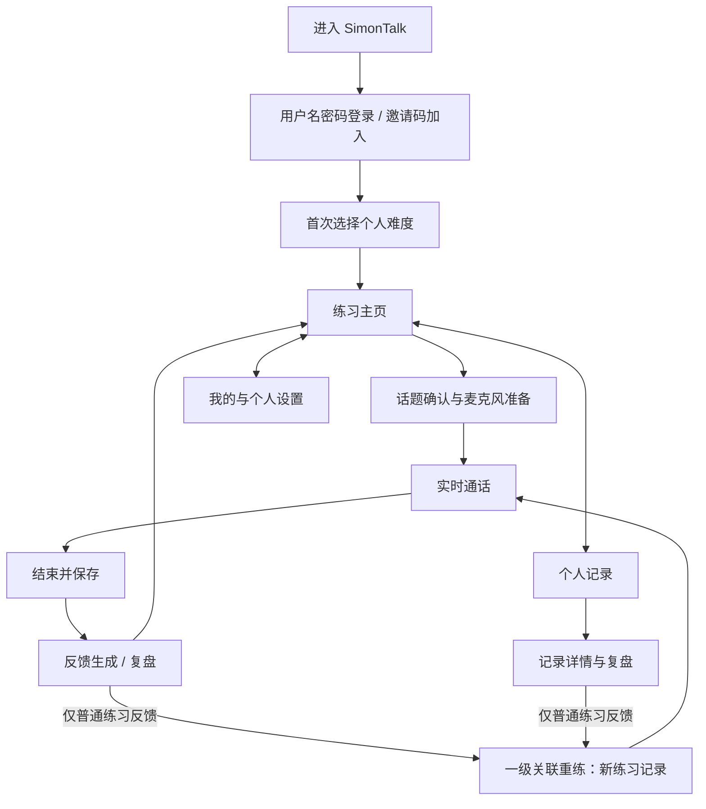

# SimonTalk 页面与交互规格

2026-10-26接入更新：本人重练复盘已在原页面展示“意思表达”和“目标问题”两轴、解释及本次精确引文；有评价而零建议仍展示，旧无评价结果不推断改善。查看全文复用已保存文字入口，读取失败/换号撤下两轴，不从重练反馈派生二级。[契约](../architecture/2026-10-26-rehearsal-evaluation.md)与[实际页面/Preview验证](../development/2026-10-26-rehearsal-evaluation-verification.md)已有；真实通话/重练媒体仍待准入。

日期：2026-10-15。本文定义页面与交互规格，具体决策状态见第 1 节；实现与验证进度统一见根目录 [HANDOFF.md](../../HANDOFF.md)。

本文件依据[首版产品设计](../superpowers/specs/2026-10-15-simontalk-mvp-design.md)与[产品及技术调研](../research/2026-10-15-product-and-stack-review.md)，把一次个人练习从进入、开口、结束到复盘和重练的行为写清楚。它定义用户应能理解和控制的行为，不代表技术路线已通过验证。技术质量与实际设备验证统一见[验证计划](../validation/2026-10-15-validation-plan.md)。

颜色、字体、间距、组件、伙伴动效及响应式参数统一见[视觉设计规范](2026-10-15-visual-design-spec.md)。本文维护操作语义，视觉规范细化呈现；新增视觉默认仍为建议，不改变用户确认的功能范围。

## 1. 决策状态与范围

| 状态 | 内容 |
| --- | --- |
| 用户已确认 | 在中国大陆，由本人和几位朋友使用；Flutter 覆盖 iOS、Android、Web；首期练英语日常交流；实时自动接话，允许自然插话；每人独立难度；会后集中反馈；整体采用 A 方向“轻量语音伙伴” |
| 2026-10-20新增确认，尚待实现 | 首版不提供转写纠错入口；重练判断原意与目标问题是否改善，允许不同说法；正常结束立即停止麦克风和声音，短暂等待最后一句最终识别再保存；首版只保留一级重练，同一句可多次练，不从重练反馈继续派生；删除普通练习包含全部关联重练，单删某次重练不影响其他记录 |
| 工程采用 | 邀请码加入、用户名和密码登录；忘记密码联系维护者取得单次重设凭证，再由本人设置新密码；具体字段、错误和安全边界以账号接口契约为准 |
| 本文设计建议，待评审 | 难度先分为基础 / 进阶 / 熟练；“练习 / 记录 / 我的”三个一级入口；浅色、留白与单一强调色；森林绿作为候选强调色；约五分钟作为轻量练习建议而非强制结束时间；以下未明确确认的按钮文案、默认显示偏好与后台暂停细则 |
| 尚未确定 | 伙伴名称及最终形象；视觉规范候选色值与字体的最终采用；正式语音供应商、型号及恢复能力；是否保存原始录音 |

账号的目的为隔离各人的设置、历史与反馈。邀请码、用户名/密码及单次密码重设已在开发授权内工程采用，不表示用户逐项审批；登录和加入字段、会话及错误规则遵循[账号接口契约](../architecture/2026-10-15-account-api.md)，不再保留多套待选登录流程。

首版“忘记密码”进入“联系维护者”：由维护者线下核实身份，提供单次重设凭证，再由用户自行设置新密码。该凭证不得成为查看私人历史的入口，也不由维护者代设或接收新密码；成功重设后要求重新登录。此流程不提供短信验证码或自动邮件找回。

“几位朋友使用”指各自进行一对一 AI 练习。首版没有多人同场通话、好友动态、排行榜或向朋友共享私人对话。个人难度不由其他人的表现决定。

本文把新提出的交互规则当作可评审建议；上表明确标为用户确认及新增确认的内容属于已确认范围。质量、延迟、重连时间等数值统一由验证文档规定，本文件不承诺尚未测得的阈值。

2026-10-20补充的正常结束、终止待核对、复盘和一级重练规则集中对应[练习收尾与复盘契约](../architecture/2026-10-20-practice-completion-and-review-contract.md)。2026-10-21客户端协调器已有受限有界end、无字幕输入登记及内存前缀/上下文门；正式练习/结束页面、真实供应商行为、可信终止和复盘重练仍未接通，不能据此宣称具备完整能力。

## 2. 信息架构与跨页规则

2026-10-22分批接入：按[基础版本开发路线](../superpowers/plans/2026-10-22-basic-version-development.md)先接普通练习首页/准备、真实通话/结束、历史/删除和已有复盘阅读。B1仅上线可用的练习与设置入口，记录导航随B3真实列表一起接通；话题、独立辅助生成及重练入口随对应能力交付，不提供占位操作。下图保留完整目标流程；当前已实现状态以HANDOFF为准。B1面对未配置准入显示实际不可用原因，不进入假通话；进入已有内容保持只读，不开麦、不建连或生成反馈。



窄屏使用底部“练习 / 记录 / 我的”；通话、结束保存和复盘是完整页面，不保留底栏，避免误触切走。宽屏可以把同样的一级入口放入侧栏，不增加一套新的流程。

同一账号同时只有一场正在进行的练习；再次点开始、重复点击或在另一设备打开时，先显示已有练习的实际状态。“查看已有练习”不会接管连接或打开麦克风；可继续时才提供继续入口。“结束已有练习”只提交结束意图和已有内容，不承诺随后立即能开始。原连接为 `unknown` 或终止待核对时，禁用继续、重新连接和新练习，说明正在核对原连接；只有服务端核验终止并解除占用后，才重新检查准入，由用户明确继续或开始。不能用本地关闭、租约到期、内容保存或删除成功替代终止证据。后台生成反馈本身不占用通话，但旧连接仍待核对时也不能开始下一次练习。

页面返回应回到实际入口：从记录进入的复盘返回记录，从刚结束的练习进入复盘则返回练习主页。重练返回原复盘时保留滚动位置。浏览器前进后退和 App 返回手势遵守相同规则。

2026-10-23 B1已接入`/practice`首页及`/practice/prepare`准备页；`/account`保留偏好，未保存修改的明确返回先确认。进入准备不请求服务/麦克风，明确开始先核对current；真实准入未就绪则显示503原因，已有占用或读取失败阻止新建，刷新仅查询。登录恢复/不可达时保留这些地址，已有复盘/文字路径不变。实现范围与测试/浏览器证据见[入口验证](../development/2026-10-23-practice-entry-verification.md)，不代表真实媒体可用。

## 3. 通用呈现约定

- 主操作只保留一个清楚的视觉重点；危险操作写出影响，不只写“确定”。文中引号内文案均为建议稿。
- 连接、听取、思考、播报和中断用文字与动效共同表达，不让用户仅凭颜色或声波猜状态。
- 练习中不显示实时语法红线、错误计数或发音分数。用户主动求助时可以得到表达辅助；系统性的纠错留到会后。
- 最终转写与临时识别字幕区分。尚未稳定的字幕使用“识别中”表现，改写后不把旧片段重复留在历史。
- 历史保留当时的话题、难度和辅助设置快照；修改个人难度不改写过去的记录。当前通话内的字幕、中文提示、翻译和静音开关立即生效，显示变化不改变本场难度快照；个人默认难度影响下一场练习。
- 对话文本和反馈只属于当前账号。截图、导出和分享不作为首版页面操作。

## 4. 首次使用与练习前准备

首次进入顺序为：理解用途 → 登录 / 加入 → 选择难度 → 练习主页。用途说明用一屏短文表达“和 AI 聊日常英语，结束后一起复盘”。兴趣可跳过，避免开口前填写长问卷。

难度选择必须由本人明确选择，提供可读的能力描述，不冒充正式水平测评：

| 难度 | 建议说明 | 对体验的影响 |
| --- | --- | --- |
| 基础 | “能说简单词句，希望多等我一会儿” | 常见词、短问题、较慢的目标语速、更多组织句子的空间；按需给中文意思和英文开头 |
| 进阶 | “能聊熟悉的话题，想把话说完整” | 适度追问、完整表达、必要时提供英文表达辅助 |
| 熟练 | “能连续交流，想聊得更自然” | 自然语速与细节追问、理由和观点表达；仍允许停顿和主动求助 |

这三个档位没有未经验证的 CEFR 对应，也不锁定用户。说明下方提示“随时可以调整”，首次选择后到主页。

麦克风权限在用户首次点“开始聊天”时请求，而非进入应用就弹系统框。请求前说明用于本次语音练习。浏览器还需确认安全访问环境、可用输入/输出设备与声音播放能力；申请权限本身不代表练习已开始。用户点开始后的设备准备可能打开本地麦克风，系统可出现麦克风使用标识；在媒体及模型就绪前，不向模型上送音轨，也不显示“正在听你说”。优先在需要时才采集，具体平台行为需验证，不能保证所有平台授权时都完全不启用本地采集。

准备页或轻量面板包含所选话题、难度、“开始语音练习”及返回入口。麦克风状态可为未请求、可用、被拒绝、设备不可用。只有用户明确开始且权限可用后，才建立语音练习；本地音轨准备不等于已连接模型。用户在准备或建连期间取消时，立即释放已打开的本地麦克风与音轨，并忽略迟到的就绪事件。

权限被拒绝时显示“还没有麦克风权限”，说明通过系统设置或浏览器地址栏授权，提供“重新检查”和“回到练习”。仅当系统允许再次请求时才再次拉起系统框。永久拒绝时给对应平台的设置指引；用户授权回来后重新检查，不立即开始收音。权限不是必选入门步骤，拒绝后仍可浏览本人已有记录与设置。

2026-10-17工程细化：Web偏好页提供独立“麦克风检查”，用户点开始后仅观察本机输入振幅，最多30秒，不录音、不上传、不建模型连接。准备状态与许可等待分别可理解，授权等待20秒可取消；停止、后台、设备/音频上下文中断和账号组件销毁均释放，晚到许可不会重新开始。此检查不代表AI练习、语音识别或发音评分已可用。实现与硬件验收边界见[本机检查设计](../superpowers/specs/2026-10-16-microphone-check-design.md)。

## 5. 练习主页

```text
练习                                  当前难度：进阶 [调整]
今天想聊点什么？
[                    开始自由聊天                    ]

日常话题
[周末计划  ·  分享一个安排] [饮食  ·  说说你爱吃什么]
[兴趣爱好  ·  聊聊最近在做的事] [旅行  ·  描述想去的地方]

上次练习：周末计划 · 已有复盘                      [回看]

              练习          记录          我的
```

自由聊天为主入口；少量话题为可选起点，不要求完成课程路径。话题卡写出一个轻量交流目标，点击后进入准备状态，可直接开始或返回换话题。没有学习历史时不展示虚构 streak、能力分或进步百分比。

页面保持显示当前难度，避免用户不知道本次将如何交流。时长若出现，只写为“建议聊几分钟”，不倒计时施压，也不在建议时长到点后自动结束。后端额度触发结束属于另一种明确状态。

有未完成练习时，主区域按实际状态显示话题和可用操作。已安全暂停且服务端允许恢复时显示“你有一场暂停的练习”与“继续 / 结束并保存”；原连接终止未知时显示“上一场连接状态待核对”，可查看已有内容、刷新状态或结束并保存，继续及新练习禁用并说明原因。刷新只查询，不接管连接或自动开麦。只有反馈尚在生成且原连接占用已解除时，保留轻量进度卡，开始新练习仍可用。

## 6. 实时通话页

```text
[关闭 ×]             周末计划 · 进阶                 [显示选项]
                     已练习时长

                     轻量伙伴 / 语音动效
                     正在听你说
                  你可以直接说，也可以自然插话

英文字幕：可展开；稳定转写与识别中片段有区分
[需要时查看这句中文意思]

中文提示：独立区域，仅在开启且需要辅助时出现
[给我一个英文开头]                  [说慢一点]

         [静音麦克风]       [我来说]       [结束并复盘]
```

伙伴是轻量陪练形象，可以用简洁语音动效表达；不依赖写实数字人才使页面成立。显示时长用于理解练习长度，不等于已结算账单，也不把连接等待伪装成有效练习时长。

### 6.1 自动接话与两种打断

正常流程为用户开口 → 连续听取 → 判断一轮表达完成 → AI 组织回答 → 播报。用户组织句子时应获得空间，不把每一次停顿都当作已说完；不同难度的等待策略由真实语音验证确定。

**自然语音打断是必需能力。** AI 播报时，用户直接开口即可停止旧播报并进入听取。系统同时停止本地旧音频、取消旧生成或丢弃旧回复后续片段；不能在用户讲完后接着播上一次未讲完的内容。上下文须与用户实际听到的内容一致，不能把被取消且未播放的文字当作已沟通的信息。

**“我来说”是并存的显式控制。** AI 正在说或准备回答时，点击后立即停止/取消旧回复并交还说话机会。它不要求按住，也不要求每轮点击。自然打断失灵时此按钮可帮助用户继续，但验收不能以“按钮能取消”替代“直接开口能打断”。

噪声造成疑似打断时，不能把噪声自动写成用户原话。AI 若停止而没有识别到有效表达，回到“正在听你说”，不擅自补一句用户没说的话。异常频繁出现时提供设备与耳机提示，归入质量验证。

### 6.2 辅助信息分别控制

| 控件 | 内容与行为 | 建议默认 |
| --- | --- | --- |
| 英文字幕 | AI 和本人已识别的英文对话；可展开、收起，不影响麦克风与自动接话 | 开启，可收起；偏好可记忆 |
| 中文提示 | “可以说说原因”等交流引导、求助入口的中文说明；不自动把每句英文译成中文 | 开启，可单独关闭；关闭后仍可主动求助 |
| 中文翻译 | 对某条具体英文内容按需查看中文意思；与上述两个开关分离 | 默认不自动展示，逐条点击 |

关闭中文提示不关闭英文字幕；关闭字幕不自动禁止按需翻译，也不改变难度。若收起的字幕中收到需解释的提示，用可访问的轻提示告知入口，不强行展开。求助生成的英文开头和中文说明作为辅助内容标识，不混入用户转写，不参与“用户已经会说”的评估。

点击“给我一个英文开头”只展示简短文字辅助，不自动朗读抢话；没有结果时允许关闭或重试。“说慢一点”作为当前练习请求，影响后续播报，不自动重播旧句；是否同步修改个人默认语速由用户在设置中另行决定。上述文案与默认值属于设计建议。

### 6.3 语音状态与按钮行为

连接状态、对话轮次和麦克风开关是不同维度。静音时停止发送用户音频；AI 已经开始的播报可以继续，播报结束后明确显示“麦克风已关闭”，不再显示“正在听你说”。静音不自动解除。处于暂停、重连或结束时，即使按钮保存为“开麦偏好”，也不能继续采集/发送音频。

| 状态与用户可见文字 | 音频行为 | 麦克风按钮 | “我来说” | 结束主操作 |
| --- | --- | --- | --- | --- |
| 准备权限 / 设备 | 未进入练习；用户点开始后可能启用本地麦克风，但不上送音轨 | 显示授权或设备入口 | 不显示 | 返回练习并释放已打开设备 |
| 建连中：“正在连接” | 尚未进入有效听取；就绪前不上送音轨 | 不可用，说明待连接 | 不可用 | “取消连接”；取消后释放本地设备且不再后台重试 |
| 等待用户：“正在听你说” | 开麦时听取；静音时不听取 | 可静音 / 开麦 | 不可用，并说明现在可以直接说 | 结束并复盘 |
| 用户说话：“在听，请继续” | 持续收音，不因界面操作提前结束该轮 | 可静音；静音会明确停止这轮收音 | 不可用 | 结束并复盘；立即停止收音，按正常结束规则有界等待已发送内容的最终识别 |
| AI 组织回答：“正在想怎么回应” | 等待新回复，仍支持开麦后的自然插话 | 可静音 / 开麦 | 开麦时可用；静音时显示需先开麦 | 结束并复盘 |
| AI 播报：“正在说” | 播放新回复，开麦时可被自然打断 | 可静音 / 开麦 | 开麦时可用；点击取消旧回复 | 结束并复盘 |
| 网络中断：“连接中断，已暂停” | 停止收音发送与旧播报，不累计有效练习时长 | 不可用，保留静音偏好 | 不可用 | 结束并保存已有内容 |
| 已暂离：“练习已暂停” | 停止拾音与播报，媒体已释放 | 继续前不可用 | 不可用 | 结束并保存已有内容 |
| 终止未知：“上一场连接状态待核对” | 本机不采集或播放；不能据此认定其他设备或上游已停止 | 不可用 | 不可用 | 结束并保存已有内容；不据此解除连接占用 |
| 正常收尾：“语音已停止，正在保存最后一句” | 已停止收音和播报；仅在固定窗口内接收原连接已发送内容的最终识别，完成或超时后释放剩余连接 | 不可用 | 不可用 | 不重复提交；可回主页查看收尾状态，返回不重新计时 |
| 正在保存：“正在保存这次练习” | 收尾已封存，不再接收旧媒体事件；上游终止状态独立显示 | 不可用 | 不可用 | 不重复提交；可回到主页查看保存状态 |
| 已结束 / 保存失败 | 不再收音或播报 | 不显示通话控制 | 不显示 | 进入复盘或重试保存 |

“我来说”在静音时不能悄悄打开麦克风；应显示“先开启麦克风”提示。连接恢复后恢复到明确的等待状态，不自动重播已听过的 AI 内容，也不把重连前未确认的字幕重复提交。

## 7. 结束、离开、断线与后台

### 7.1 明确区分结束和丢弃

点击**“结束并复盘”**本身就是明确结束意图。2026-10-20用户确认：立即停止本地麦克风和声音，短暂等待已发送的最后一句完成最终识别，再保存；期间不恢复拾音、上送新音频或播报。页面先显示“语音已停止，正在保存最后一句”，完成或超时后关闭剩余连接、封存本次内容并进入保存状态，同时核对上游终止。超时缺失时说明“最后一句可能不完整”，不把临时字幕当成最终原话。

正常收尾工程默认从首次点击结束起等待最多3秒，任何适配调整的总上限为5秒；重复点击、迟到事件、请求重试或切换路由均不能后移截止时间，原租约更早到期则提前停止。只接收原账号、原练习和原连接中已发送内容的最终识别，以及已被停止的原AI回复的文字和播放边界证据，不接受新回复、恢复播放或跨连接内容。连接断开、后台/锁屏、设备中断、账号变化或媒体/账号作用域销毁执行立即停止，不等待最后一句；丢弃也不等待。具体供应商收尾能力仍需实测，当前同步stop不等于已实现该正常结束流程。结束后不能通过页面返回重新激活原媒体会话；后续开口属于新练习或关联重练，仍受原连接终止核验和准入限制。

本地媒体已关闭与供应商已停止计费必须分别记录。适配层取得可验证的终止结果后，才能确认上游终止；没有确认时标记为 `unknown`，用量显示“待核对”。已确认本机停止时，文案可为“本机语音已停止，连接与用量待核对”，不能宣称所有费用已经停止。文字保存、反馈生成和可回看记录不必等待结算结果；它们成功也不解除连接占用。终止核验完成前继续、重连和新练习保持禁用，不承诺点“结束并保存”即可立即恢复练习。

终止核验超过配置的重试上限时，改为“连接结束暂未确认，请联系维护者”，提供诊断编号、只读刷新和已有内容入口，不无限转圈。刷新不会重新建连；维护操作也不能无证据强行解锁。

点关闭、系统返回或路由离开时，不把“离开页面”静默等同于“丢弃”。建议先暂停收音和播报，再显示离开面板：

- **继续练习**：关闭面板，仅在媒体与服务端准入均允许时明确恢复听取；需要新连接时先核验旧连接终止，不续播已取消的旧回复。
- **结束并复盘**：保留本次内容并结束；有有效转写时生成反馈。
- **丢弃这次练习**：再确认“本次对话文字和复盘不会保存”。确认后结束并删除本次内容，返回主页。已产生的供应商用量不会因丢弃撤销。

没有有效内容时，“结束并复盘”改为“结束并返回”，避免承诺一份不存在的反馈。未完成建连就取消不生成成功学习记录；成功建连后即使没有可靠表达，也保留“未获取有效内容”的状态记录，便于解释用量。已建连但无内容的调用仍可有用量记录；不能把“没有可复盘内容”表述为“没有费用”。

系统强制退出、浏览器关闭或应用被杀无法保证展示确认框。服务端以已保存的内容收尾，记录标为“意外中断”；未确认保存的片段应明确可能缺失。恢复入口先让用户查看已有内容，不默认丢弃，也不在用户再次打开页面时自动收音。

### 7.2 网络中断与恢复

短暂断线立即停止本地媒体并封存现有内容，不进入正常结束的最后一句等待。原页显示“连接中断，已暂停”，可结束并保存已有内容或查看状态。旧连接终止未知时显示“正在核对上一场连接”，禁用重新连接和新练习；核验完成前不得自动建立新连接。只有服务端核验终止、解除占用并重新通过准入后，才可进入有界恢复；此时显示“正在尝试恢复连接”与“停止恢复 / 结束并保存”。恢复次数与窗口由技术验证确定，不能无限显示连接中。自动恢复失败后提供“重新连接”和“结束并保存”，每次重试仍先通过相同核验。没有内容时另提供回主页。

恢复成功属于同一次练习的新连接段，保持原话题与难度；只保留已确认文字，清除旧音频队列。若用户曾静音，继续保持静音；若连接中出现设备或授权变化，重新检查后由用户继续。无法恢复同一上下文时说明“需要开始一场新练习”，先结束旧记录，并在服务端核验原连接终止、解除占用后才允许用户开始；不能界面显示一场而实际悄悄开另一场。

不同连接段的供应商用量分别追踪并归入本次练习，避免重复计时或重连后消失。页面显示与账单是否一致需要技术验证，不能仅用本地秒表结算。

### 7.3 切后台、锁屏与音频占用

**首版建议只支持可见前台练习，待用户审议。** 在客户端收到后台、锁屏或 Web 页面隐藏通知时立即暂停，停止本地拾音和 AI 播报并释放本地媒体，同时请求终止上游连接，不等待最后一句识别；不承诺后台连续对话。返回后显示暂停或终止待核对的真实状态，只有服务端核验终止并允许恢复后，才由本人点“继续练习”重新检查设备并建连，不能自动打开麦克风。

平台未及时通知或进程被强制结束时，服务端超时可以收尾业务记录、清理自己持有的资源，但**不能据此保证已关闭客户端直连的 P2P 媒体或已停止供应商计费**。上游状态按前述规则确认，无法确认则为 `unknown`、费用待核对。可靠终止能力与后台事件覆盖由验证计划检验；不能用一条“服务端兜底”文案省略这一边界。

电话、其他 App 抢占音频、耳机断开或输出设备改变时，也进入可理解的暂停/设备状态。耳机断开不应把私人 AI 内容突然大声切到扬声器；提示“音频设备已变化”，由用户确认继续。设备恢复不重复播放已听过的句子。

## 8. 保存与反馈状态

结束不依赖反馈成功：先保存练习，再生成反馈。反馈生成属于独立任务；用户离开页面后仍可在记录中看到最新状态，重复打开不自动重复发起付费生成。

| 状态 | 页面内容与操作 | 记录表现 |
| --- | --- | --- |
| 正常收尾 | “语音已停止，正在保存最后一句”；可返回主页，固定截止时间不随页面变化延长 | 显示收尾中；不提前标为已保存，超时说明可能缺失 |
| 正在保存 | “正在保存这次练习”；已停止音频并封存收尾。可返回主页，不让按钮重复提交 | 显示待保存状态；重试不产生另一条记录 |
| 上游终止待核对 | 与保存/反馈状态并行显示“连接与用量待核对”；可查看已有内容、刷新或回主页 | 内容可已保存，但不显示可继续或可新建；不把未知用量当作零 |
| 保存失败 | “语音练习已结束，文字暂未保存完成”；保留平台当前可恢复内容，提供重试保存 | 不假报已保存；按下文的平台边界恢复，Web 刷新后不能保证找回未提交内容 |
| 反馈生成中 | 显示话题、已保存的有效练习时长与“正在整理表达建议”；可看已有转写或离开 | “反馈生成中”，完成后更新同一记录 |
| 反馈成功 | 展示复盘，最多三条有依据的建议 | “可复盘” |
| 反馈失败 | “对话已保存，建议暂时没有生成”；提供“重试生成 / 看对话 / 返回练习” | 保留文字与失败状态；用户重试对应同一练习 |
| 无有效音频 | 没有检测到可用的本人说话片段；说明未生成反馈，提供检查麦克风；原连接占用解除并通过准入后才可重新开始 | 已建连时保留“未获取有效内容”的可删除状态记录，不计为成功练习，不伪造分数 |
| 音频存在但无可靠转写 | “这次没有获取到可靠的对话文字”；与没说话、没授权区分；可保留中断状态，原连接占用解除并通过准入后才可重新开始 | 不从猜测文字生成反馈，已有可靠片段仍可回看 |
| 内容不足 | 有可靠用户表达，但不足以支持多项建议；展示实际可支持的零至三项与“多聊一点可获得更多建议” | 允许少量反馈，不补足三条 |

“有效音频”以评估本人真实表达为产品与测试意图，尽量排除 AI 播报、设备回声、提示文本、噪声或旁人声音；**首版不要求声纹身份识别，也不承诺精确识别说话者身份**。无法区分噪声、旁人声音或不可靠转写时标为不确定，减少或跳过无法支持的判断。具体标准由验证文档定义，页面不能用任意秒数冒充质量或身份判断。

文字补交恢复按平台分开：移动端建议使用短期受保护的待提交文字队列，在有效保留期内允许恢复保存，具体期限与清理由技术文档统一；退出账号、丢弃或删除相应练习时一起清理。Web 首版只在当前浏览器页面进程的内存保留未提交文字，队列归属原账号和原练习作用域，不归属某个通话路由组件。正常收尾、回主页、查看记录或再次进入保存页不销毁这份队列，保存状态继续可见；不能因关闭通话路由而丢失待提交文字。账号变化或相关作用域销毁时停止旧任务并清理，不向新账号补交。

上述路由内恢复不承诺刷新、关闭浏览器页面或浏览器回收后恢复；再次进入只能恢复服务器已确认的文字，未提交片段可能缺失。保存失败页应说明“返回主页可继续查看保存状态，刷新或关闭页面可能丢失未保存内容”，不能一律声称“稍后回来内容还在”。这是待实现的队列生命周期要求，不能以现有组件销毁或内存journal的测试代替完整页面验收。

保存与生成均需幂等：重复结束、网络重试或重复点击不会创建重复记录；生成中的按钮不可再次触发同一任务。失败后由用户明确重试，新尝试如产生上游用量需计入用量记录；不是创建另一场练习。删除记录时应同步取消未完成反馈；即使任务晚到也不能重新展示已删除内容。

最终文字补交窗口与本地短暂收尾分开：服务端首次受理结束后工程默认30秒内接收补交，重试不延长。会话已封存时，保存重试可核对已接收事件，但不能承诺再补入新文字；显示实际已保存内容及缺失状态，不无限提供同一失败操作。该窗口不延长麦克风或媒体连接。

## 9. 复盘页

```text
[返回]                        练习复盘
周末计划 · 进阶 · 日期 · 有效练习时长
下次试试：说完安排后，再补一句原因。

你已经做到：有依据时展示一个具体做得好的点

表达建议 1 / 最多 3
你的原话：“...”                         [定位到对话]
可以这样说：“...”
为什么：简洁中文解释
类型：语法 / 表达更自然                  [练这一句]

[查看完整对话]                         [回到练习]
```

每条原话必须来自本会话**可靠的最终用户转写**并能定位到对应话轮。不能为使反馈显得完整而改写原话、拼接两轮为一句或引用 AI 的句子为用户表达。若识别不确定，明确提示并跳过不适合判断的部分。

2026-10-20用户确认：首版不提供修改转写或标记“识别有误”的处理入口。此范围选择不取消上述可靠性要求，也不能把收到最终识别结果等同于原话一定准确。

按[评价资格规则](../architecture/2026-10-20-practice-completion-and-review-contract.md#5-反馈依据与不确定性)区分可评价、不确定与排除的具体话轮版本。缺少供应商confidence不自动排除正常句子，语法不标准也不直接等于识别错误；只跳过依赖实际疑点的判断。复盘统一说明“建议基于本次识别文字”，没有可评价内容作为正常结果显示，不让用户反复点击生成来追求成功。

反馈最多三条，优先选择影响沟通或常见复用表达的点，可以少于三条或为零。没有明确错误时可以给“表达更自然”的建议，但必须沿用真实原句、标明为可选改法，不把有效表达判成错误。不作“你全对了”或“英语很好”等超出样本的保证。

复盘不提供未经音频评测支持的音素分数、考试分或口音结论。基于文字只能评估文字支持的语法、用词和表达；建议表达应符合用户原意，不能改变事实。没有依据的赞美也不虚构为成绩。

完整对话默认收起。展开后显示角色、顺序及可靠最终文字；若某段 AI 音频被打断，标识已中断或只显示实际播报部分，不能把未播内容当作完整已发生对话。点击原话定位后能返回刚才的建议位置。

## 10. 关联重练

2026-10-20用户确认首版只保留一级重练：“练这一句”只出现在普通练习的反馈中，重练自己的反馈不提供该入口，也不能通过直接链接或请求继续派生。普通练习中同一条建议可以多次重练，各次互为同级记录。

点击普通练习反馈中的“练这一句”先显示原句、建议表达与练习目的，主按钮为“开始重练”。仅查看句子不建立媒体连接；点开始后才检查权限并发起新练习。服务端在创建时核对来源普通练习与反馈项均属于本人、仍存在且关系一致；不能只依赖页面隐藏按钮。如果来源被另一页面删除、来源版本或关联发生变化，停止创建并提示返回记录刷新，不沿用缓存中的目标表达。

重练使用本人的原话和建议上下文，以自己的表达说一遍或换个日常情境，不要求机械背出唯一标准答案。用户的实际重练仍进行真实转写；不因为页面上展示了建议句，就直接把建议句存成用户说过的话。

若换情境，开始前展示并固定本次要表达的意思，按该意图评价；不能用原场景事实机械判错，也不能在评价时替用户临时编造意图。

**每次重练是新练习：有独立会话 ID、实际开始/结束时间、转写、状态与用量记录，并始终关联来源普通练习和所选原反馈项。** 它不覆盖原转写，不重置原反馈，不把重练费用记成原会话已经支付的一部分。同一条建议多次重练也分别记录；重复点击开始仍只能建立一次。创建与来源删除须有并发保护：若删除先完成则不得创建；若创建先完成则纳入删除范围，范围变化必须重新确认。

重练通话页明确标记“重练：周末计划中的一句表达”，支持自然打断、静音、结束和异常恢复等同一套行为。结束后展示本次实际完成情况；若没有可靠转写，说明未能判断，不直接宣布“已掌握”。提供“回原复盘”“再练一次”“回到练习”；“回原复盘”始终指向来源普通练习。“再练一次”仍关联同一来源普通练习和原反馈项，重新验证来源、独立创建记录并计量，不把当前重练当成新的父练习；来源已删除时禁用并说明原因。

2026-10-20用户确认的完成情况包括两个判断：本次是否表达原意，原建议针对的问题是否改善。允许不同的正确说法，不以是否逐字复述建议句判定成功；引用本次实际转写说明判断依据，证据不足时显示无法判断。这是待实现的重练评价要求。

结果分别说明“已表达原意 / 意思发生变化 / 无法判断”和“本次达到目标 / 问题仍存在 / 这次尚未练到目标 / 无法判断”。没有出现可检查的目标表达时不算成功或能力失败，一次达到目标不表示已经掌握；技术生成失败另给重试状态。

## 11. 记录、详情与删除

2026-10-23 B3已接`/history`和`/history/:sessionId`，首页导航为“练习 / 记录 / 我的”。当前列表每页10项，展示原难度快照、登记时间、普通/重练、真实练习与保存状态；没有可靠有效时长/分数时不展示。详情独立提示连接待核对，sealed才提供保存文字与复盘入口，重练可回来源详情；初进仅GET，返回保留列表页与滚动位置。刷新清旧回第一页，翻页网络失败保留原页，身份/来源失效清除。未设难度可读取旧记录。子列表/新建重练/删除随对应单元交付；下文保留完整首版目标。实际HTTP/自动测试与五态组件渲染已验，浏览器/Preview因Work设置禁用待补，见[契约](../architecture/2026-10-23-practice-history.md)及[报告](../development/2026-10-23-practice-history-verification.md)。

记录列表只展示当前账号的数据，按实际练习日期排列。每项包含话题、难度、有效练习时长、状态，以及普通练习 / 重练标识。可用状态包含反馈生成中、可复盘、反馈失败、意外中断、无可用内容；状态不使用单一模糊“完成”覆盖所有情况。

首次为空时显示“第一次练习会保存在这里”及开始入口。加载失败显示重试，不能展示空列表使用户误以为内容已删除。缓存内容若展示，需要提示更新时间或离线状态，不混入另一个账号的缓存。

点列表进入详情，查看真实转写、反馈状态与重练关联。普通练习展示其一级重练记录与反馈中的“练这一句”入口；重练详情可回到来源普通练习的复盘，其自身反馈不再派生重练。另一设备已删除对应记录时，当前页面说明内容已删除并回列表，不继续展示缓存中的原句和反馈快照。

2026-10-20用户已确认删除普通练习同时删除全部关联重练；具体操作与并发规则如下：

1. 用户在详情的次级菜单选择“删除记录”，确认框写明将删除本条文字、反馈及保存的音频（若后续决定存音频），删除后不可在页面恢复。
2. **删除普通练习时，级联删除其文字、反馈及全部一级重练。** 确认框使用服务端返回的关联数量和范围，包括未完成的重练，例如“将删除这次练习和 2 次关联重练，包括对话文字与反馈”。没有重练时直接说明只删除本条；不能隐藏删除范围。提交时重新核对已确认的范围；另一页面新增重练导致范围变化时，展示新数量并重新确认，不能静默扩大删除。
3. 删除某一次重练，只删除这次重练及其自身文字、反馈和关联任务，不删除来源普通练习或同级其他重练；一级限制保证它不存在下一层重练。
4. 服务端确认应用内容已删除或已不可见后回列表并移除对应条目；请求失败则保留条目，结果未知时先刷新核对，不先显示成功。删除同时撤销相关内容的写入和新建重练资格，取消反馈任务并发起关联活跃连接的终止，晚到结果不能重新创建已删内容。内容删除成功不表示上游已终止；终止未知时保留最少核对状态和连接占用，继续禁用恢复及新练习，不再展示被删原文。
5. 成本用量账本仅保留核对所需的最少字段，不保留原话、转写或反馈内容；已消耗额度不返还。用量页可显示“已删除练习”的统计，不提供返回已删原文的入口。

上述范围已确认，2026-10-23 B4已接`/history/:sid/delete`独立确认页及[真实范围/删除/凭据接口](../architecture/2026-10-23-practice-deletion.md)：默认键盘焦点“保留记录”，读范围零写，明确确认才DELETE；成员变化409须重新读并确认，未知回复只能核对或明确重放原请求，成功清旧内容并回列表刷新。unknown仍占用，当前只登记blocked核验，不声称上游终止。恢复面板显示内容已删并隐藏正文动作。自动测试/真实HTTP/四态组件图已验，实际浏览器/Preview因Work设置禁用待补，[证据](../development/2026-10-23-practice-deletion-verification.md)。供应商终止/删除和备份恢复演练后续补齐。如改变已确认范围，须同步产品决定、确认文案、关联规则与验收。

## 12. 我的与个人设置

| 区域 | 首版建议内容 | 生效边界 |
| --- | --- | --- |
| 个人信息 | 当前账号标识、退出登录；忘记密码联系维护者取得单次重设凭证 | 只影响本人；切换账号清除上一人的页面数据 |
| 练习难度 | 基础 / 进阶 / 熟练及能力描述 | 下一场生效；不修改历史或静默改变正在进行的练习 |
| 语速偏好 | 正常 / 更慢的易懂描述 | 保存为下一场偏好；具体语速由模型能力验证，不承诺固定倍率 |
| 显示辅助 | 英文字幕、中文提示分开开关；翻译默认按需 | 当前显示开关立即生效，只改变呈现，不改本场难度快照；个人默认值供后续练习使用 |
| 用量 | 本人的语音、反馈与重练用量；用量更新时间及不可用状态 | 不是本地时长估算账单；无可信数据时显示暂不可用 |
| 记录说明 | 保存哪些数据、如何删除、会话音频传给所选服务完成练习 | 录音持久化政策尚待确认，不能写成已确认承诺 |

2026-10-18已在非首次引导的偏好页增加“未结束练习”只读入口：点击后读取本人current，按明确操作查看原连接记录、分页或刷新。载入、空、失败和身份变化有独立状态；失败保留明确重试，身份异常需重新确认账号。业务状态与客户端观测分别显示，unknown不因local_closed显示而变为结束；只查看不会创建、接管、续租、取消、恢复媒体或开麦。当前正式练习/结束保存流程尚未接入，不能把此入口称为完整断线恢复。实现边界见[只读恢复契约](../architecture/2026-10-18-readonly-recovery-client.md)。

同日增加独立的“清理未开始的准备”动作，仅在可见安全候选时显示。弹窗说明会取消同账号其他页面的这项准备、保留历史并由服务器复核；“保留准备”默认聚焦且不发请求，“确认清理”才操作原快照。清理中防重复，成功提示这项准备已清理并引导刷新；拒绝提示状态可能变化，超时/网络失败提示结果未确认，均需刷新后重新确认。unknown不提供此按钮，不把本地关闭记录当作远端终止。详见[清理契约](../architecture/2026-10-18-preparation-discard-api.md)。

2026-10-20增加原连接“查看已保存文字”：仅本人明确操作后GET、翻页及刷新，用户最终文字和AI生成内容分开，AI标“播放情况未知”；不创建练习、申请媒体或触发新提交。按当前已读最大修订展示，空修订不恢复旧文字，未读完提示内容可能更新，间隔不被说成具体丢失原话。文字在有界可滚动/选择区域显示，翻页与刷新按钮在区域外，支持键盘及大字号。翻页失败保留已接受版本并从原游标重试；刷新先清空文字，身份错误/删除/准备清理清掉原记录，需明确刷新或重新确认账号。此入口仅查看未结束练习的查询连接，不是完整历史页，也不提供纠错、恢复语音或反馈。详见[文字读取契约](../architecture/2026-10-20-final-transcript-read.md)。

反馈方式保持会后集中，不新增默认实时纠错开关改变已确认的体验。设置不能触发麦克风收音，也不能在页面切换时自动加入通话。

设置保存中给出局部状态；失败保留用户选择并提示未同步，不能假报成功。多设备设置冲突以服务端已确认版本为准，重新进入时显示实际值。退出登录前若有活跃练习，沿用继续 / 结束保存 / 丢弃的明确流程，并提示尚未提交内容的处理边界；账号实际变化时立即停止旧媒体和任务，不等待最后一句。退出凭证处理遵循账号契约：移动端可先清本机并说明服务端撤销失败；Web退出失败保留真实Cookie状态、明确提示重试，不能假报已退出。

## 13. 通用错误态与操作恢复

| 情况 | 可理解的表现 | 恢复操作及限制 |
| --- | --- | --- |
| 未登录 / 身份过期 | 说明需要重新进入个人账号；媒体停止，不让旧账号内容暴露在新账号下 | 登录后回到本人未完成记录；恢复时不自动收音 |
| 邀请无效 | `invite_invalid`统一显示“邀请码无效或已失效，请联系维护者获取新邀请码” | 允许更换；不推断或承诺区分过期、已使用和已撤销 |
| 麦克风无权限 | 说明没有权限，不显示录音动效 | 系统 / 浏览器设置指引、重新检查、返回 |
| 没有可用设备 / 音频被占用 | 明确显示输入或输出问题 | 选择可用设备或恢复后继续；不默认为网络故障 |
| 浏览器禁止播放声音 | “需要点一下开启声音” | 本人点击后启用播放，不丢弃已确认对话 |
| 建连失败 | 保留话题和难度，说明尚未开始对话 | 重试 / 回主页；取消后忽略迟到的连接成功事件 |
| 练习中断网 | 原页暂停、立即停止音频，保留已确认内容，不等待最后一句 | 结束保存或查看状态；旧连接终止核验通过后才允许有界恢复 / 重新连接 |
| 原连接终止未知 | “上一场连接状态待核对”；保存内容与连接占用分别呈现 | 可结束并保存、查看已有内容或刷新；恢复与新练习禁用，不能用结束或删除绕过核验 |
| 服务繁忙 / 模型不可用 | 用普通语言说明暂时无法继续，原始错误仅用于诊断 | 重试或结束保存；不能反复建立隐藏付费会话 |
| 额度不足 | 开始前说明暂不能发起；通话中到限则明确结束并保存 | 回看记录；不隐式启用新的费用方案 |
| 保存失败 / 反馈失败 | 分开描述，避免“反馈失败”被理解为练习丢失 | 对应幂等重试与已保存文字入口 |
| 页面离线 | 只展示可用的本人缓存与同步状态 | 恢复后重新核对；不承诺未保存数据已上传 |

错误文本不直接向用户显示供应商代码、密钥或调用堆栈。可附复制诊断编号的次级入口，避免把技术排查内容放到主通话流程。

## 14. 响应式与可访问性

手机与窄屏 Web 采用单列，通话控制固定在安全区内，字幕区域可滚动但不推走结束按钮；系统键盘弹出时输入与退出入口仍可操作。横屏及大字号时允许减少伙伴动效占位，先保留状态、字幕和控制。

平板和桌面 Web 使用受限宽度内容区。宽屏可将伙伴与字幕并排，字幕收起后主区域重新居中；左侧导航的隐藏与显示不改变当前练习状态。反馈与记录可用列表 / 详情两栏，但删除仍需明确确认。断点、宽度和大字号回退按视觉规范的建议起点实施，并通过真实内容验证后调整，不视为已确认的最终像素。

- 触控目标至少 44×44 逻辑像素，提供足够间隔；通话中的结束按钮不会紧贴静音按钮。
- 支持系统文字放大与重新排版，不把按钮文案截断为含糊图标；中文和英文混排保持可读行高。
- 状态、静音、选中与出错均提供文字和可访问名称，不能只用颜色；深浅色模式保留足够对比。
- 语音动效尊重减少动态效果偏好；不闪烁，不依赖持续大幅脉冲表示所有状态。
- Web 支持键盘访问全部控件、可见焦点和合理顺序；弹窗圈定焦点，关闭后返回触发控件；Esc 遵守明确的离开流程，不直接丢弃通话。
- 不默认启用容易误触的全局麦克风快捷键；屏幕阅读器能读出开麦 / 静音、连接中 / 暂停等状态。
- 屏幕阅读器只播报关键状态改变，不逐字播报临时字幕，避免与 AI 音频相互覆盖；最终对话可由用户主动阅读。
- 字幕及中文提示分别可见，翻译按需；听力辅助不强迫用户开启所有中文信息。音量由系统控制，设备切换须清楚提示。

## 15. 评审清单与验证边界

文字稿可用以下情境评审：

1. 新用户拒绝麦克风仍能回主页；权限申请不等于练习开始，用户点开始后的本地准备与模型就绪后的上送清楚区分，取消立即释放设备。
2. 基础用户停顿不会被界面催促；AI 播报时直接开口与点击“我来说”均可交还话轮。
3. 中文提示、英文字幕分别关闭，翻译仍按需，不出现一个开关改变所有辅助的情况。
4. 点返回会看见继续、结束保存和丢弃的区别；直接结束、意外退出与断线均不悄悄丢记录。
5. 回后台后停止拾音，回前台由本人继续；耳机断开不会无提示外放。
6. 反馈失败仍可回看已保存文字；无有效音频、无可靠转写和内容不足分别呈现。
7. 每条原话能定位真实转写；最多三条，无明确错误时只给适当的自然表达建议。
8. 同一句重练两次出现两条同属来源普通练习与原反馈项的独立记录和对应用量；重练反馈不再派生，直接请求也不能绕过；不同正确说法按原意和目标改善评价。
9. 删除普通练习前明确看到全部一级重练数量；并发新增导致范围变化时重新确认，删除先完成时不能再创建。确认后原文、反馈和一级重练一并消失；只删单次重练不影响原练习及同级记录。用量账本不保留已删原话。
10. 不同账号看不到对方历史；手机、窄屏 Web、宽屏 Web、键盘和大字号可走完同一闭环。
11. 正常结束立即停麦停声，仅在从首次结束操作计算的固定窗口内接收原连接最终识别；重复点击、切路由和迟到事件不能延长，断线或账号变化立即停止且不等待。
12. 收尾或保存中返回主页，原账号与练习的待提交文字继续保留并能查看状态；刷新或关闭浏览器页面仍明确可能丢失未保存内容。
13. 旧连接终止未知时，结束保存和删除均不能启用继续、新连接或新练习；服务端完成核验和准入后才解除相应禁用。

其中页面结构、文案和默认偏好可在文档评审中调整；真实语音接话、自然打断、后台停止、设备兼容、数据恢复和用量可靠性必须以技术验证补证。本文件没有声称这些能力已实现或验收通过。


2026-10-21恢复入口新增真实“保存状态”分区：明确点击后读取服务器固化摘要和原连接核验记录，分别显示未登记、等待封存、已保存或已有内容仍有缺口；ending显示实际固定截止，sealed刷新不能补回丢失内容。只有真实blocked核验记录才提示需维护者协助，保存不等于可信终止/费用已停止。局部刷新失败清旧结果并明确重试；已经确认结束登记时不会重新出现旧准备清理。completed标题为“上次练习状态”及“练习已结束”。该入口只覆盖current返回范围，不是完整历史或正式通话保存页；[详细设计](../superpowers/specs/2026-10-21-saved-status-recovery-design.md)与[真实浏览器验证](../development/2026-10-21-saved-status-recovery-verification.md)。

2026-10-21已提供[复盘任务客户端能力](../architecture/2026-10-21-review-client.md)：仅原sealed输入可明确创建，refresh只有GET，未知HTTP写入按原key/body明确确认；确定次数冲突须先刷新再重试。失败读取撤下旧显示，账号/来源变化清理，空建议与不可评价分别保留真实业务态。[客户端验证](../development/2026-10-21-review-client-verification.md)。

2026-10-22[复盘阅读页](../architecture/2026-10-21-review-page.md)从已读sealed摘要的“查看复盘”进入，地址可刷新。初次先GET本人保存来源，再读取已有复盘，恢复账号/连接失败时保留地址而不读练习。未建时“整理表达建议”、blocked/failed且允许时“重试整理”、不确定写入时“确认上次整理请求”分别对应原客户端动作；“刷新复盘状态”只读，409冲突先刷新。等待/不可评价/有效空建议/成功明确区分，成功仅显示实际0–3项及三类标签，原话、建议和解释可选择复制。来源重新读取先撤下旧结果，相同target保留原不确定动作；身份变化清旧并明确重新确认账号。应用内返回保留偏好，直接地址也可返回。页面提示识别文字依据/保存缺口，未增加话轮跳转、重练、完整对话、统计或历史入口，不等于本节完整闭环验收。[本批验证](../development/2026-10-21-review-page-verification.md)。

### 已保存文字与原话定位当前实现（2026-10-22）

[独立阅读页](../architecture/2026-10-22-saved-transcript.md)现接本人sealed来源的“查看已保存文字”，无任务、blocked或不可评价也能只读回看；实际成功建议各有“定位到对话”。普通网址`/practice/:sid/transcript`，定位网址再含原item UUID，地址不放原话/hash。定位初页以对应用户话轮为首段，显示“建议对应原话”和精确引用；翻页保留该锚，可“回到原话”。跨连接分段、段数来自实际分页，返回复盘保留原建议位置；直接网址返回同练习复盘。

首读/刷新先撤旧再确认封存输入，翻页网络失败保留原页和游标并明确说明；账号/来源失效清正文。AI客户端报告的已播片段和此前版本明确标识，生成全文独立折叠为“查看已保存生成文字（不代表已播放）”；unknown/not_played/revoked与无可用文字分别说明。不新增音频回放/重练/删除占位。按钮在稳定标题后、正文前，窄屏换行、至少48，可选择文字，正文不作为整块liveRegion。当前有自动、HTTP/wire及组件渲染证据；实际浏览器/Preview点击因Work设置禁用待补。[验收边界](../development/2026-10-22-saved-transcript-verification.md)。


### 2026-10-22 一级重练服务端基础

[一级重练后端契约](../architecture/2026-10-22-rehearsal-preparation.md)现可从普通来源有效item读取完整目标、确认hash后创建独立准备，并读子目标/同级记录。这里只接后端，现有页面没有“练这一句”或重练确认入口；后续仍须按本规格接目标确认、独立准备和返回来源，接入顺序按第2节的基础版本安排。没有用占位页替代媒体/改善评价，前批保存文字的实际浏览器/Preview点击仍待补。[实际证据](../development/2026-10-22-rehearsal-preparation-verification.md)。

### 一级重练确认/准备客户端进展（2026-10-23）

普通复盘建议经本人ordinary核验后显示“练这一句”，进入`/practice/:sourceId/rehearse/:itemId`只读完整目标。已设难度者可选择本次难度，明确确认才创建独立准备；未设难度者仅看目标并去设置。未知回复只确认原key/body，不自动另建；尚未开始的已知准备可明确安全放弃。历史子详情可进入`/practice/:childId/rehearsal-target`只读固定目标，不能派生二级；来源失效撤下目标，子历史独立保留。重连/深链接保留地址；实际状态已经变化时不声称语音尚未启动。见[客户端契约](../architecture/2026-10-23-rehearsal-client.md)与[验证](../development/2026-10-23-rehearsal-client-verification.md)。真实语音/改善评价及完整关联列表仍待后续，实际浏览器/Preview因工具禁用待补。

### 来源关联重练列表进展（2026-10-23）

普通本人历史详情的“查看关联重练”进入独立`/history/:sourceId/rehearsals`，每页10条元数据，可进入子历史详情后返回原列表页。翻页成功焦点/滚动到页标题；网络失败保留原页，刷新清旧回首页，游标删除及身份/来源失效清空。子不提供此入口，未设难度仍可只读，来源复盘失效不影响列表。列表不推测难度、保存完整性或改善结果。见[契约](../architecture/2026-10-23-related-rehearsals.md)与[验证](../development/2026-10-23-related-rehearsals-verification.md)；真实媒体/改善评价及实际浏览器验收仍待补。

历史入口衔接修补（2026-10-23）：记录行及文字/复盘/删除/来源/目标/关联按钮在点击时复验当前账号、当前页或详情及其操作资格；刷新、换页或身份变化后旧回调不跳旧地址。账号操作中显示禁用，恢复后可继续，不将账号busy误显示为读取记录。见[历史契约](../architecture/2026-10-23-practice-history.md)及[验证](../development/2026-10-23-history-action-guards-verification.md)。

删除衔接修补（2026-10-23）：可信删除凭据后，当前客户端补齐恢复快照、重练目标/资格与关联列表scope的清理；晚到读取不能填回旧内容。保留、范围冲突或删除未确认不提前清理；current重新读取仍可保留unknown连接与用量待核对。当前重练flow随成功返回历史结束，原key不自动重放，准备/媒体独立状态不在此失效。见[删除契约](../architecture/2026-10-23-practice-deletion.md)及[验证](../development/2026-10-23-deletion-read-scopes-verification.md)。

普通准备衔接修补（2026-10-23）：首页显示当前偏好，准备页显示“本次难度”，使用已知配置或点击时冻结的请求快照。未知结果确认不套用后来更新的偏好；预检未登记则回到最新偏好。首页/准备的旧按钮在点击时复验账号、忙碌、当前占用和资格，新开始不使用已变化的旧显示，原请求确认仍保留原key/body。取消和恢复沿用既有安全流程。见[契约](../architecture/2026-10-17-client-preparation-lifecycle.md)及[验证](../development/2026-10-23-preparation-snapshot-verification.md)。

删除确认点击修补（2026-10-24）：账号操作中、删除/核对进行中，旧保留/确认/读取/核对/重试回调不能绕过禁用。确认必须对应刚展示的范围；范围重新读取后旧按钮不确认新范围。路由已切换（含旧页面尚未销毁）时旧确认不DELETE、旧保留不覆盖或弹出新页面。忙碌结束后仍需本人明确操作，原请求重试继续复用原key/body。见[删除契约](../architecture/2026-10-23-practice-deletion.md)及[验证](../development/2026-10-24-deletion-action-guards-verification.md)；实际浏览器验收继续待补。

2026-10-24新增每次保存情况：历史详情“查看保存情况”进入`/practice/:sid/save-status`，独立核对未登记/保存中/完整/缺口；连接占用和实际用量另列。进入与刷新仅2次GET、共8秒，状态不一致要求明确重读，失败先撤旧。账号恢复保留地址，未选难度可读，返回实际历史详情；可信删除清除此纯读scope。见[契约](../architecture/2026-10-24-saved-practice-status.md)和[验证](../development/2026-10-24-saved-practice-status-verification.md)。它提供服务器结果，正常结束/上传重试仍在原账号/媒体scope，真实浏览器与完整通话验收待补。

复盘点击资格修补（2026-10-24）：整理、确认原请求、重试和结果跳转在点击时核对当前页面、账号与实际展示的来源/任务。账号操作中保留原建议和重练入口并禁用，显示账号操作提示；恢复/切页/销毁后旧重新连接不能重置账号。见[复盘契约](../architecture/2026-10-21-review-page.md#当前操作资格2026-10-24)。

重练目标确认点击修补（2026-10-24）：旧确认不能使用后选的难度或重读后的目标；原请求核对与放弃绑定实际展示对象，切页/账号操作后旧按钮零请求或导航。账号busy保留目标并禁用操作，明确提示账号操作；控制器实际请求时仍允许正常返回，不声称请求已取消。见[客户端契约](../architecture/2026-10-23-rehearsal-client.md#点击时复验2026-10-24)。

阅读操作修补（2026-10-24）：已保存文字的翻页/回原话、关联重练的翻页/记录行绑定实际展示页；旧按钮在账号busy、go/push切页或展示页变化后不能请求或导航。关联列表迟到读取不抢其他页面焦点；实际读取中仍可正常返回。见[阅读验证](../development/2026-10-24-reading-action-guards-verification.md)。

普通入口路由修补（2026-10-24）：首页开始/设置/记录、准备页开始/原请求确认/取消/返回在实际点击时重新确认当前页面。覆盖或离页后旧取消不取消原准备、旧返回不操作新页面；账号操作单独提示，当前真实准备中仍可正常取消和返回。见[契约](../architecture/2026-10-17-client-preparation-lifecycle.md#普通入口路由资格2026-10-24)。

共享恢复面板修补（2026-10-24）：读取/复盘绑定展示来源，打开及确认清理时复验当前页面、账号和原准备。旧清理Dialog按钮不pop新页面；账号操作以中性色提示、保留数据并禁用动作，嵌入准备页时只提示一次。见[契约](../architecture/2026-10-17-preparation-recovery-and-cleanup.md#共享恢复面板的当前操作资格2026-10-24)。


设置点击与异步身份修补（2026-10-25）：保存/退出/返回/放弃及本地编辑绑定实际展示账号、偏好与草稿；账号忙碌、API/provider变化或路由已切换后旧回调无效。确认框只可关闭自身，确认期间来源变化须重新操作。已发保存迟到完成不在其他页提示；CSRF等待固定原账号，旧完成及自动恢复不能覆盖新身份，双恢复仅最新操作发布。正常初设、保存反馈与退出/取消文案保留。详见[契约](../architecture/2026-10-25-account-action-scope.md)及[验证](../development/2026-10-25-account-action-scope-verification.md)，不代表原生安全存储或浏览器版本矩阵已通过。


认证入口修补（2026-10-25）：登录/注册/重设的按钮与键盘提交、页间导航及密码显隐绑定原展示状态和当前路由，忙碌/身份/provider变化及切页后的旧回调无效。clearError不会解除忙碌；旧请求尚未发出时在CSRF/凭据等待后被抑制，迟到完成不覆盖新状态。reset成功不在后来页面提示或强制返回登录。详见[契约](../architecture/2026-10-25-auth-operation-scope.md)及[验证](../development/2026-10-25-auth-operation-scope-verification.md)，不改变原表单和会话规则。
