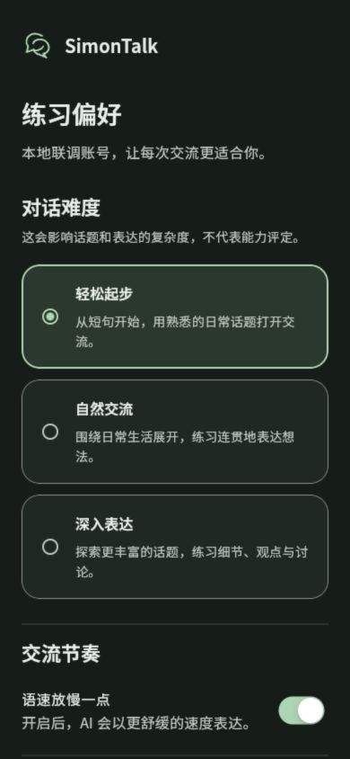
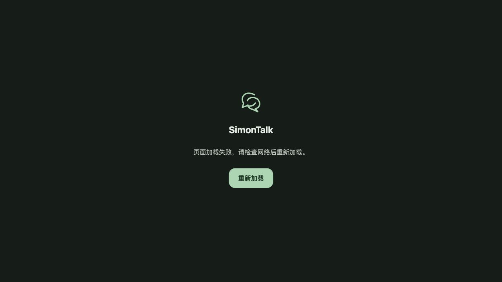

# Web 完整中文字体压缩验证

日期：2026-10-16（Asia/Shanghai）。实现位于当前功能分支；没有推送、部署或模型调用。

## 结果

Noto Sans SC源TTF **17,772,300字节**，完整WOFF2 **7,782,072字节**，减少 **56.2%**。保留30,890个Unicode映射、全部字形轮廓/度量、字体布局/变体表和100–900可变字重；不裁剪为当前界面文字。中文TTF仍在仓库作为源文件，已不进入发布Web包。Roboto保留本地默认回退。

Web单独在main运行应用前注册压缩字体，原生使用系统字体。字节长度与SHA-256不匹配即进入已有HTML启动失败/重载界面。摘要元数据由生成器更新、CI核对，不能用一个正常HTTP状态就认为字体有效。

## 实际检查

- `flutter analyze`通过；Flutter28项和Node启动10项通过；格式检查通过。增加摘要验证后重新通过分析与release构建。
- `flutter build web --release --no-web-resources-cdn --dart-define=API_BASE_URL=http://127.0.0.1:8000`通过，最终构建61.7秒。
- `uv run --python /opt/anaconda3/bin/python scripts/check_web_fonts.py --web-build apps/client/build/web`通过。该命令使用脚本声明的固定fontTools/Brotli隔离环境；源/产物全量比较、元数据和发布文件校验通过。生成器早期缺少WOFF2、随后缺少元数据的检查均先失败，再随实现通过。
- 正式产物在应用内浏览器显示完整中文登录与偏好页，390×844截图可读，无字体警告/错误日志。真实测试账号登录和退出成功，偏好未更改。
- 故障服务器分别对WOFF2返回404、HTTP200 HTML、以及等长但最后一字节翻转的内容，均显示可读的“页面加载失败”和重载按钮。临时服务器仅loopback、测试页已清理。
- HTTP200 HTML场景在修复前曾错误显示方框字业务页；独立复核据当前SDK确认FontLoader吞掉解析失败。加入长度/摘要验证后同场景正确停留在HTML错误页，等长损坏进一步验证摘要分支。

正常登录过程中曾出现一次传输失败，下一次明确重试收到`csrf_invalid`，按提示再次提交成功。保持原有不自动重放凭据规则，未改CORS/CSRF；此前应用内浏览器传输异常的根因仍未确定，不能归因为字体或宣称已修复。

## 证据与限制

这些是文件大小与本机正式产物验证，不能当成大陆网络实际传输量或首屏延迟。字体依然约7.8MB；真实手机、辅助技术、大陆网络及缓存策略仍待验证。WebCrypto只支持HTTPS或受信任localhost/127.0.0.1；普通局域网HTTP不属于当前入口。未验证超出源字体覆盖范围的字符。
