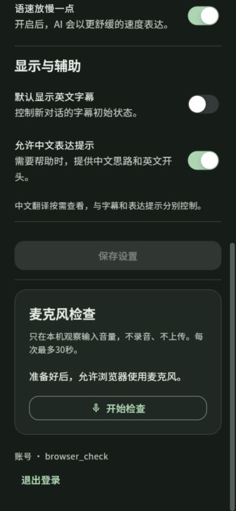
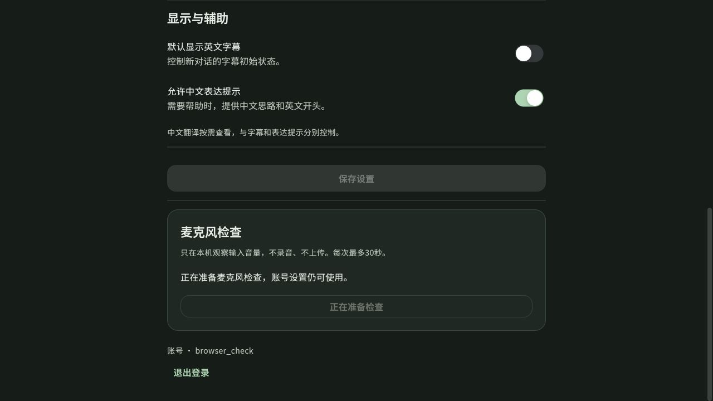

# Web 本机麦克风检查验证

日期：2026-10-17（Asia/Shanghai），工作从10月16日开始。当前功能分支本地完成；没有推送、部署或模型调用。

## 可用能力

Web完成初始难度后，在偏好页提供明确的本机输入检查。用户点击才申请麦克风，不申请摄像头；只以Web Audio展示短时输入振幅，没有录音器、文件、音频存储或上传。最长30秒；授权等待20秒可取消。静态入口不打开音频设备。

JS层负责实际媒体与AudioContext；Dart控制器负责显示、代次、超时；面板以账号ID为key。用户停止、等待超时、后台/离开、轨道结束、音频上下文中断、组件销毁均释放；取消后的晚到流立即停止，旧回调不能改写新检查。许可提示本身由浏览器管理，不能承诺页面撤销弹窗。

## 自动检查

- `flutter analyze`通过，Flutter **41项**通过，包括新增10项控制器、3项面板测试；深浅色320宽/200%字号停止可达、账号key更换释放均通过。
- `node --test test/web/*_test.mjs` **26项**通过：15项执行同一生产媒体JS的明确浏览器API替身，11项启动逻辑测试。
- `flutter build web --release --no-web-resources-cdn --dart-define=API_BASE_URL=http://127.0.0.1:8000`最终通过，36.1秒。
- 格式与diff检查通过；CI改为运行全部Web测试。后端未修改，本轮未重复42项后端测试；没有把旧记录称为本轮运行。

覆盖：未点击不请求、重复开始、拒绝/无设备/占用错误、等待取消/超时、取消后晚到授权、resume仍pending后的迟到流、后台与pagehide、轨道结束、上下文非running、全部轨道/上下文/timer/监听清理、样本不连扬声器、新旧回调与dispose、30秒到期。音量与输入信号均未当成语音识别或发音评分。

## 独立复核与浏览器结果

复核发现两项P2并修复：

1. 可选媒体脚本可能晚于Flutter运行，原先一次性读支持状态会永久误判。新增准备状态、就绪通知/失败通知、20秒准备超时与晚到恢复；订阅销毁时移除。
2. AudioContext中断时分析器可能返回冻结缓冲。现在监听statechange，并在每次采样前核查running；先移除监听再关闭，避免递归。新增失败→通过回归。

复核修复后无剩余P1/P2，独立Node26项通过。规范依据：[Web Audio中断](https://www.w3.org/TR/webaudio-1.1/#audio-context-interruption)。

正式产物在应用内浏览器实际登录成功，麦克风说明、heading与按钮可见；390×844页面可读。临时仅对本地生成的脚本延迟执行35秒，实际观察到“准备中”、超时未就绪说明、晚到后恢复“开始检查”，期间账号设置正常。故障注入后生成文件已按备份字节完全恢复，未改生产源或CORS。

没有点击真实“开始检查”、没有接受浏览器/系统麦克风许可。输入振幅、物理轨道释放、采集指示灯、系统打断与实际手机仍需真人设备验收。替身覆盖资源协议与竞态，不能证明硬件表现，也不代表AI语音、WebRTC、插话、转写或费用已接入。
