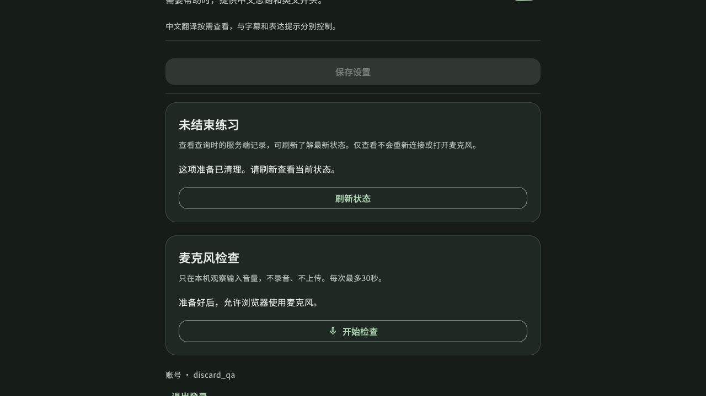

# 未开始准备的明确清理验证

日期：2026-10-18；基线ecf560a，当前本地功能分支。按[设计](../superpowers/specs/2026-10-18-preparation-discard-design.md)和[计划](../superpowers/plans/2026-10-18-preparation-discard.md)实现。真实语音准入、网关和协议仍关闭，无供应商调用、物理麦克风或原生构建。

## 实现与自动验证

新增单事务POST discard-preparation及偏好页确认动作；锁后复查完整历史、代次和身份。连接unknown、历史上游证据或缺行拒绝；成功保留原行和历史，不伪造上游终止。客户端绑定弹窗原快照，独立HTTP、8秒总截止/单调复核、串行操作及账号取消；成功、拒绝、结果未确认各有状态，不自动重放。

| 检查 | 实际结果 |
| --- | --- |
| PostgreSQL后端全量 `uv run pytest -q` | 225项通过，35.01秒；独立simontalk_test，无开发库改写 |
| 新后端清理定向 | 33项通过，4.85秒 |
| Ruff检查与格式 | 检查通过，47个文件格式通过 |
| 两库 `alembic check` | 均无待生成迁移，head f80e9c1a24bd；本批无迁移 |
| Flutter全量 `flutter test --reporter expanded` | 232项通过，约5秒 |
| 新清理Dart/组件 | 13项仓库/控制器与9项组件测试通过 |
| 新CSRF家族回归 | 4项通过；媒体组合测试同步核对复用账号令牌、不单独签发 |
| Flutter分析、Dart格式 | 无问题，71个文件无需改格式 |
| Node Web测试 | 51项通过；本批未修改JS桥接 |
| Web release发布构建 | 默认开发API版本33.7秒通过；独立测试API版本33.0秒通过，均关闭外部Web资源CDN |
| 字体完整性/发布包 | 保留30,890映射，WOFF2为7,782,072字节；发布包匹配且包含本地Roboto |
| 组件预览 | 冷启动重试自动发现10项，实际搜索呈现新增浅色及深色200%两项；滚动后两个操作按钮可见 |

后端覆盖空准备、跨客户端/过期准备、完整历史、幂等终态、严格输入、所有权/Web保护和锁后撤销；重复清理、新代次与offer竞争分别验证原子结果。确定性竞争测试证明清理先提交时网关0调用，信令意图先持久后清理409且unknown保留。客户端覆盖陈旧弹窗、重复点击、8秒截止含CSRF等待、销毁/迟到、身份变化、401、403/409/503与异常成功响应。组件覆盖取消无POST、确认才操作、成功不冒充空current、unknown无按钮及320宽/844横屏/深浅色/200%字号，无布局异常。

预览首次默认生成空列表、显示No previews detected；用Flutter自带`widget-preview clean`后冷启动重新自动发现10项并实际渲染，通过后停止并清理生成目录。未修改SDK或手写生成注册列表；首次漏检的根因仍未确定，不承诺预览热加载稳定。

先运行缺少端点/方法/组件的测试观察失败，再实现。浏览器发现CSRF问题后，先用共享Cookie模拟证明旧实现两项失败（退出csrf_invalid、并发签发2次）；修复后通过。另将迟到拒绝保护暂时回退，观察新测试令牌签发3次而期望2次，再恢复保护并通过。全量首次失败为旧媒体测试仍要求分支签发owned-csrf，实际已正确复用test-csrf；将夹具改为分支若签发即失败、校验共享值后，最终232项全部通过。

## 真实浏览器与数据库

本机IAB访问localhost:7358的真实Flutter release，连接localhost:8001 FastAPI。专用临时服务使用独立simontalk_test、明确测试准入，仅生成一个本批拥有的账号/邀请码和准备；供应商网关仍Unavailable。通过正常登录和HttpOnly Cookie/Origin/CSRF调用，不注入浏览器认证或业务状态。连接租约在浏览器操作前已安全过期，读取显示created和failed/not_started。

1. 点击查看current，打开清理弹窗再选“保留准备”：无discard请求，数据库准备保持created。
2. 再次确认，POST返回200；页面显示“这项准备已清理。请刷新查看当前状态。”；数据库为cancelled、cancelled_before_signalling且有ended_at。明确刷新后GET current返回空，页面才显示没有未结束练习。
3. 用正常API和测试准入再建立准备，追加一条client_observed local_closed；打开弹窗后，在独立测试库明确种入unknown/信令意图模拟并发变化（不是实际供应商调用）。旧确认POST返回409；页面显示拒绝及刷新入口。刷新后unknown保留且无清理按钮，查看记录实际GET到该条观测；“远端是否结束尚未确认”和“客户端报告本地已关闭”同时显示。
4. 发现首次退出403后追踪到独立HTTP轮换了共享CSRF Cookie，而账号缓存仍旧。修改同一ApiClient家族共享令牌/pending及迟到拒绝保护，未修改服务端保护规则。重建release并重建本批夹具，重走登录→current→确认清理200→刷新空current→首次退出：POST logout为204，页面回到登录页。全程只有一次CSRF GET，没有自动重放或第二次退出。

临时8001 API、7358静态服务与浏览器均已关闭；仅删除本批保存ID和邀请码摘要对应的夹具，账号级联清理，剩余discard_qa为0。开发API8000使用默认关闭的准入/网关并保持运行；真实HTTP ready200，匿名清理401 unauthorized，有request-id和no-store；允许来源预检200且credentials=true。开发库只读事务核对1账号、0练习、0连接、0观测，head f80e9c1a24bd；没有开发练习种子。

## 审查与边界

独立只读审查未发现确定P1/P2，并单独重跑本批22项清理Dart/组件测试通过；CSRF追加静态审查同样未发现确定P1/P2，未并行操作数据库。这里只验收到本地测试准入与真实HTTP/UI，不是实际供应商、媒体恢复、可信终止、计费或手机验收。

本批未推送、未对外部署、未合并main。后续优先完善Web网络失败/身份变化的浏览器验收和恢复体验；模型账号/地域/预算、真实麦克风/手机条件仍按用户要求暂缓。正式练习页、协议/网关、学习闭环与费用控制尚未完成。
