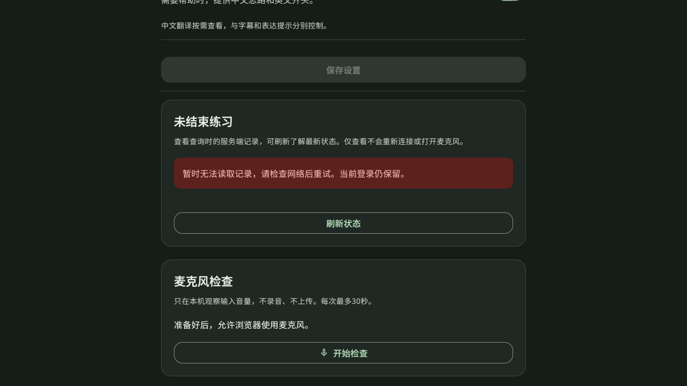
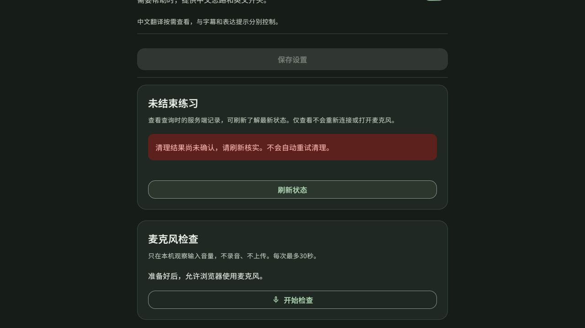
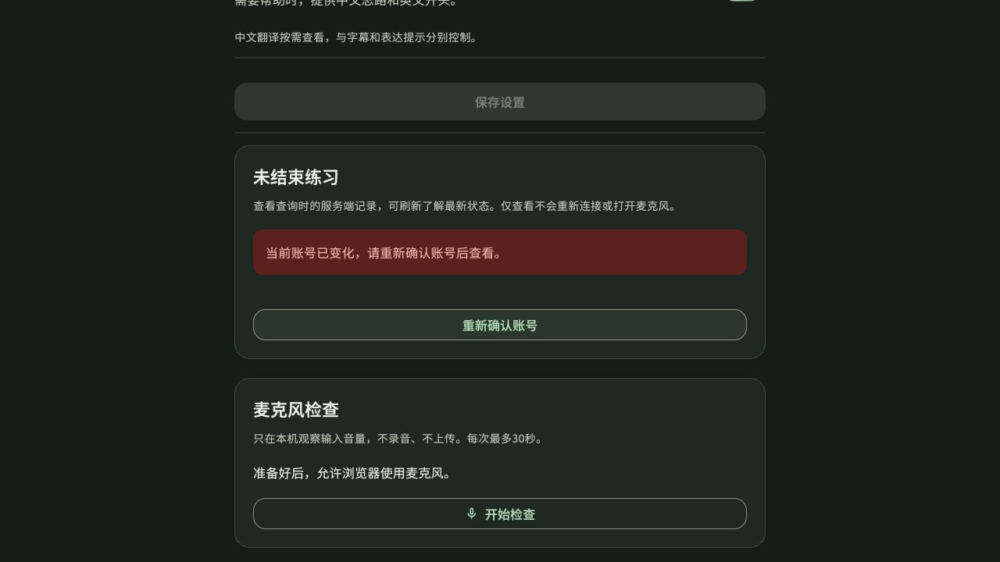
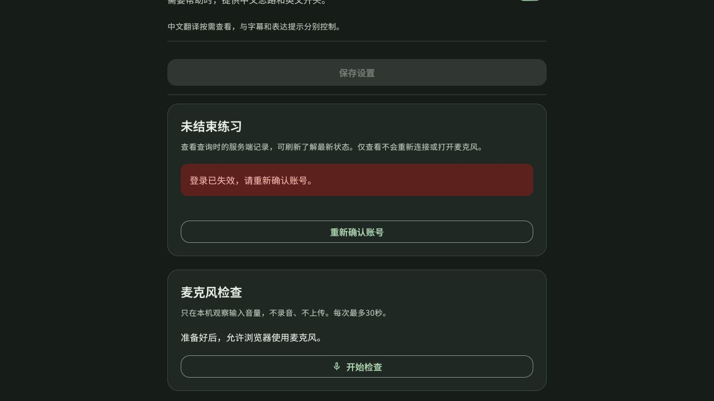

# 恢复入口失败与身份变化的浏览器验收

日期：2026-10-18；产品代码基线a6b7eab。本批执行[验收计划](../superpowers/plans/2026-10-18-recovery-browser-failures.md)，没有修改业务代码。使用上批已构建的Flutter Web release、真实IAB双标签及FastAPI/PostgreSQL；本批没有重新构建或重跑自动测试，不将上批225项后端、232项Flutter和51项Node结果计为本批新证据。

## 环境与方法

静态页localhost:7358连接localhost:8001，仅使用独立simontalk_test。本批通过正常API建立临时账号A/B、分别保存beginner/advanced偏好和未开始的准备；测试准入只存在于临时服务，真实供应商网关保持Unavailable。浏览器正常输入测试账号、登录并使用HttpOnly Cookie，未注入浏览器认证、存储或业务状态，没有申请麦克风权限。

网络失败通过真正停止临时API产生；写结果未知通过临时服务在真实端点完成后延迟12秒返回响应产生。延迟逻辑不进入仓库产品代码，不修改Origin/CSRF规则。临时维护间隔设为300秒；测试之间通过正常API重新建立准备，避免TTL影响账号隔离判断。

保留[36条请求证据](evidence/2026-10-18-recovery-browser-requests.json)：资源UUID替换为测试标签，只含方法、路径、状态码、账号绑定和顺序。第13–19条为场景间的移动API夹具准备，其余为实际浏览器请求；停止API期间失败的读取自然没有服务端条目。未记录密码、业务凭证、Cookie、CSRF值或请求体。

## 实际结果

| 场景 | 实际观察 | 结论 |
| --- | --- | --- |
| 已载入A准备后断连并刷新 | 旧准备/清理按钮消失；显示“暂时无法读取记录，请检查网络后重试。当前登录仍保留。”；账号仍为A | 网络失败没有误判为退出，旧动作不可继续 |
| 重启API后等待明确重试 | 本人点击前成功current读取仍只有1次；点击后第9条GET200重新载入 | 本次观察期间未观察到自动请求或重新建连 |
| 清理已提交、响应延迟12秒 | 数据库A原准备cancelled/有ended_at；第11条POST服务端200；浏览器超过8秒总截止后显示结果未确认，不显示成功 | 响应超时没有伪造失败回滚或已完成确认 |
| 结果未知后的明确刷新 | 原目标清理POST只有1次，无自动GET；点击后第12条GET200为空，页面才显示没有未结束练习 | 明确核实结果，没有重放写入或制造空状态 |
| 旧A页面开着弹窗，另一标签退出A并登录B | 旧确认第29条POST403；随后数据库A/B新准备均保持created、无ended_at，B目标没有清理POST | 旧账号操作未作用于任一新准备；跨标签保护保留 |
| 旧页明确刷新/确认身份 | 第30条GET携带A绑定返回409；旧数据清除，按钮变“重新确认账号”；点击后第31–32条读取B本人/偏好，页面为B和advanced | 账号变化不自动重放旧动作，新作用域不继承旧数据 |
| 查看B后另一标签退出共享会话 | 第34条logout204；旧页刷新第35条current401，清空准备/清理入口并显示登录已失效；明确确认第36条me401后回登录页 | 会话失效与网络失败有独立处理 |

第29条403是服务端对旧写操作的拒绝，不是证明上游终止。后续GET409才直接证明账号绑定变化；未因为跨标签拒绝而放宽CSRF或自动补发清理。第11条200属于服务器已提交的记录，浏览器未接受其迟到结果。

## 收尾与边界

本批未发现需要修改业务代码的确定缺陷。临时浏览器双标签、8001 API和7358静态服务均已关闭；按保存的本批ID/邀请码摘要分别删除2个邀请和2个账号，级联清理其数据，剩余本批账号为0。删除前再核对A/B新准备仍created且没有结束时间。

独立只读证据审查核对36条请求的序号、状态、来源及四张截图，与现有恢复/身份代码一致。自动行为的判断限定在本次观察窗口。截图均按原始JPEG格式保存；上批清理截图的扩展名一并更正，图片内容未改变。

开发库只读事务核对1账号、0练习、0连接、0观测，head f80e9c1a24bd；默认开发API8000 readiness200并保持运行。没有修改开发数据、默认准入/网关、依赖或迁移；未推送、部署、原生构建或供应商调用。

这些证据覆盖桌面IAB的指定场景，不是所有浏览器、真实手机、辅助技术、物理音频或真实供应商验收。此前“预检后传输异常”本批没有自然复现，根因仍未确定，不能以本次有意停止服务的网络失败替代其解释。跨进程未知创建键恢复、供应商协议/可信终止和学习闭环仍缺。
