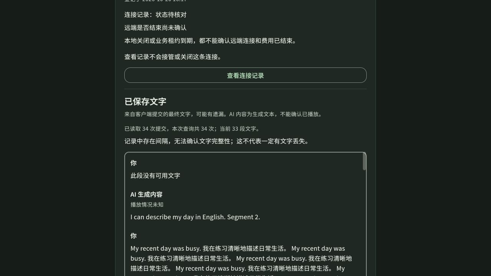
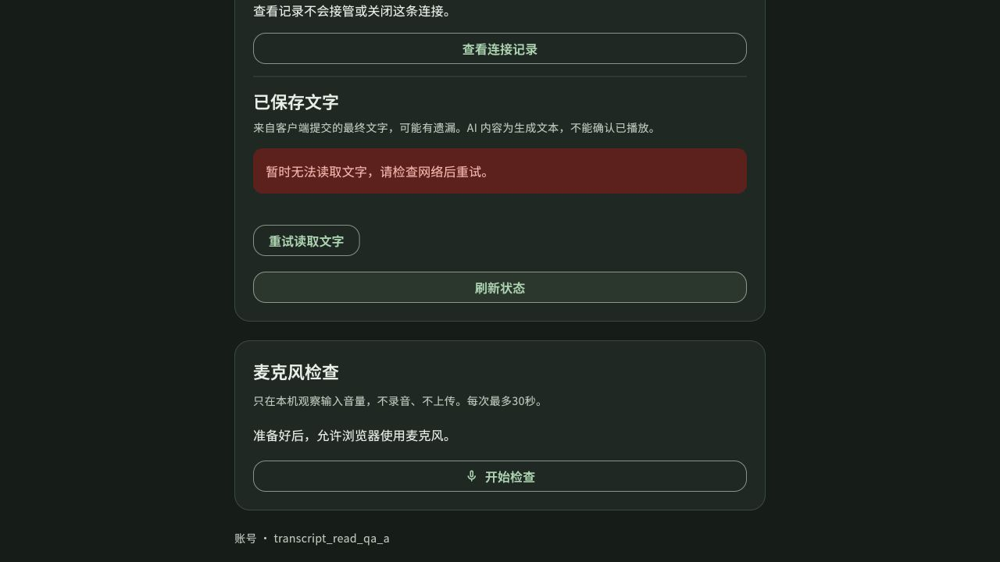
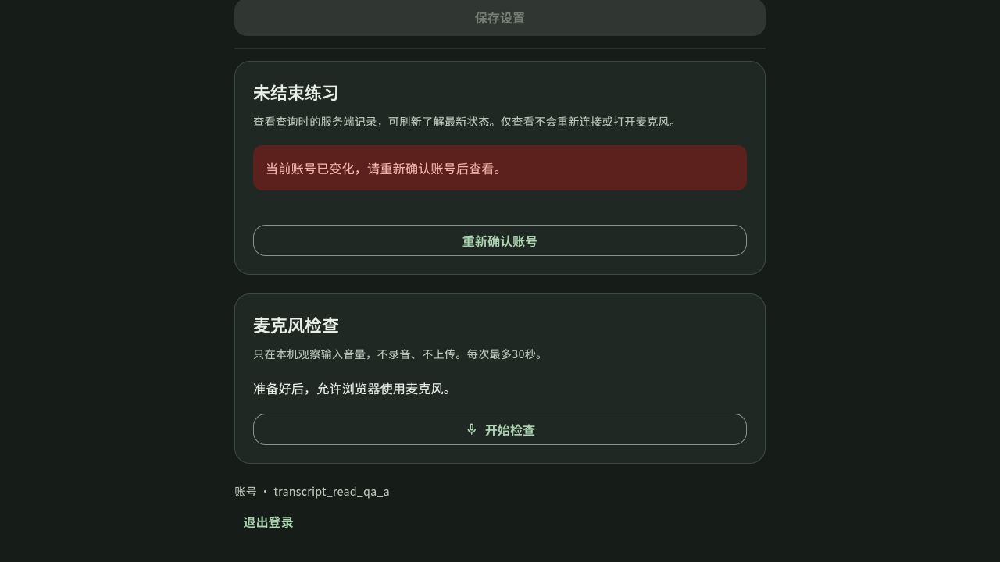
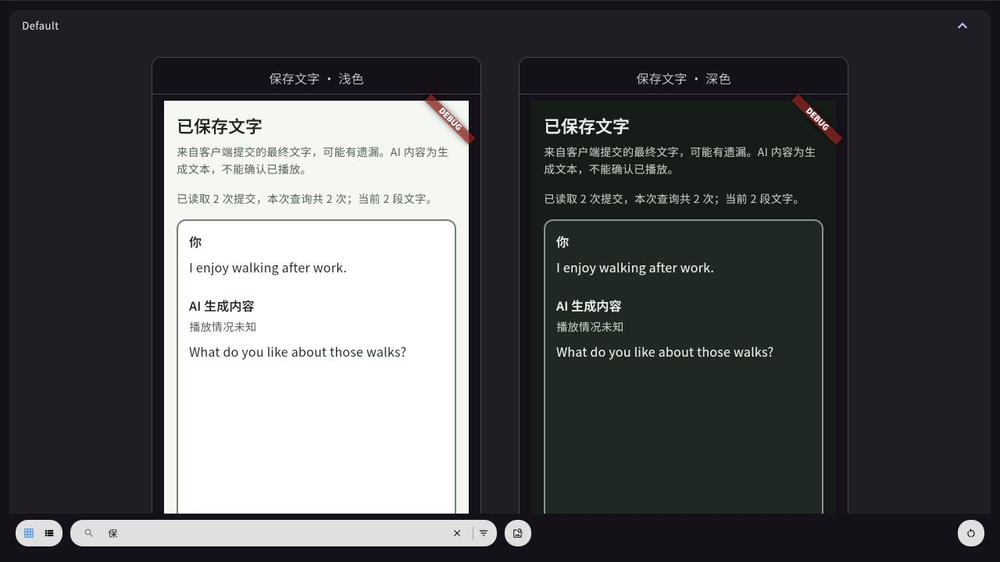

# 最终文字客户端读取验证（2026-10-20）

## 本次交付

按[设计](../superpowers/specs/2026-10-20-final-transcript-read-design.md)与[计划](../superpowers/plans/2026-10-20-final-transcript-read.md)实现账号/原连接绑定的GET仓库、不可变分页及修订重建器，并接入偏好页“未结束练习”的明确查看、翻页和刷新。读取不创建练习、控制媒体或提交文字；AI生成文本保持播放未知。这是现有恢复入口的文字查看，不是完整历史页、会话封存或反馈输入。

## 自动检查

| 检查 | 实际结果 |
| --- | --- |
| Flutter完整测试 | **435项通过**，最后复验约13秒；比前批311新增124项 |
| 新增用例 | 核心读取83、控制器18、查看组件/真实provider面板20、鼠标选择与复制3 |
| Flutter analyze | 无问题，2.0秒；最终使用原锁定依赖复验 |
| Dart格式 | 87文件，0更改 |
| Node传输/桥接 | **51项通过**，约0.61秒，包含实际Dart→JS桥接编译 |
| 实际Dart→API→PostgreSQL | **1项通过**；真实HTTP，独立测试库，无MockClient |
| QA Web release | **38.2秒通过**，回环测试API8001，仅用于下述浏览器验收 |
| 最终开发Web release | **34.5秒通过**，原锁定依赖、API8000、no-web-resources-cdn；Wasm dry run不代表实际Wasm/设备验收 |
| 发布字体 | 30,890 Unicode映射完整、WOFF2 7,782,072字节，发布包包含完整压缩中文及本地Roboto |
| 组件预览 | 官方Web previewer成功启动，27.5秒；实际查看深浅色和空态 |

核心覆盖身份/原连接/代次、严格整数/UUID/有效带时区日期、Unicode/NUL/UTF-8字节、分页排序/游标/统计/数量/容量、跨页映射/重复事件/修订、空修订覆盖、512事件/256段/1MiB及原子拒绝。控制器覆盖惰性GET、互斥、分页错误保留原cursor、刷新清空、8秒总截止/晚响应、404删除、401/409/本地账号变化及销毁清理。组件覆盖320×568、844×390、1024宽200%字号、长文滚动、深浅色、按钮状态、键盘和真实provider只读接入。

读取模型、控制器和组件先运行缺失端口/行为的失败测试再实现；补充非法account参数时出现83项中的1项失败，修复后83全过。独立核心/集成/UI审查后，鼠标双击和三击复制回归还原了焦点问题：原指针监听每次点击都抢回父级焦点，导致第二/三次选择丢失。含原生SelectionArea对照的诊断运行4通过/2失败；改为仅在阅读区及后代都没有焦点时请求焦点，保留单击全选、双击、三击三项产品回归，最终全部通过。初期测试的可空焦点断言和平台覆盖清理错误属于测试夹具问题，修正后才取得上述有效RED证据。修复后独立静态复查未发现剩余确定问题。

本批无后端业务或迁移变更，未重跑pytest或迁移；后端276项通过保留为[前批证据](2026-10-20-final-transcript-storage-verification.md)，不计成本轮重测。

## 真实HTTP与数据库

临时API8001使用独立`simontalk_test`及测试准入，实际供应商网关仍Unavailable。只创建两名临时测试账号：A有34次提交、33段当前文字、6101字节；B有2次提交、76字节。A首批32条后另有同turn的空revision2及sequence35的新段，用于验证跨页替换与合法间隔；混合长文为人工测试内容，未调用语音或模型。

实际Dart读取首批32/34后续读，重建得到34次提交/33段，空修订覆盖原文；旧不可变快照不变、全部文字字节与统计一致、AI为unknown。前后连接status/termination/lease不变。A读B连接以及A身份仓库读B原连接均404，B自己的读取只含B文字；本地账号改变清空旧控制器。日志位于本机`/tmp/simontalk-transcript-read-wire.log`。

## 浏览器与预览

使用真实Web release、HttpOnly Cookie登录与普通页面操作，未注入页面状态：

1. A明确查询未结束练习，再点击“查看已保存文字”，看到32/34及尚未读完提示；点击“查看更多文字”后为34/34、当前33段，旧首句变为“此段没有可用文字”。间隔提示不声称一定丢词；AI始终标“播放情况未知”。键盘PageDown改变惰性阅读区可见内容，Tab能够离开阅读区到刷新按钮。
2. 主动停止本轮临时API，点击“刷新文字”，旧正文清除，出现网络错误和“重试读取文字”，账号仍保留。恢复API后没有页面自动重放；明确点击重试才从0读取首批32条。这个受控断网不能解释此前未定因的浏览器预检/传输问题。
3. 另一标签退出A并登录B。旧A标签点击翻页，原账号头与B Cookie冲突，实际GET返回409；页面清除旧连接及全部正文并提示“重新确认账号”。明确确认后偏好切换为B的深入表达，重新查询/查看仅有B的2段文字。Cookie变化不会在发请求前自动广播到旧标签，不声称瞬时跨标签清除。

浏览器记录共18次GET200、1次GET409、初始未登录GET401一次、10次OPTIONS预检及3次正常登录/退出POST；所有练习业务请求均为GET或OPTIONS。脱敏[请求与清理证据](evidence/2026-10-20-final-transcript-read-browser.json)不含Cookie、token、密码或正文。结束前数据库仍为A34/B2条、字节未变、两连接均unknown/unknown且未启动信令。仅删除本轮两个账号的已消费邀请码及账号关联数据，逐项确认级联文字清除；开发库未加测试练习。临时API8001/Web7358/预览服务及测试标签已关闭，凭证夹具已删除。

组件预览实际显示文字的深浅色与空态，样例不进入实际账号数据。初次离线启动受默认pub.dev缓存与不完整预览生成目录影响；通过官方`widget-preview clean`，使用原镜像缓存后启动成功，未修改SDK。预览截图见下，生成目录随后用官方命令清理。未执行物理读屏器或真实手机验收。

## 构建与剩余范围

最终开发Web release使用`--no-pub --no-web-resources-cdn`，指向默认开发API8000。一次构建漏加`--no-pub`触发依赖重新解析；已恢复原锁文件，以镜像缓存离线严格按锁文件重建package_config，锁文件无差异，435项测试及分析复验通过。误解析后的中间构建不作为最终发布证据，无依赖升级进入提交。默认开发API ready200；开发库head b97d2a641e30、1账号/0练习/连接/观测/文字。

现有正常stop仍立即封闭回调；有界end/draining、版本绑定播放前缀、可信终止核验、服务端封存和评价资格尚未实现。下一单元按工作区最新收尾规则先补有界收尾与中断事实，再推进播放持久证据/结束固化；对应当前实现边界见[技术设计](../architecture/2026-10-15-technical-design.md)。模型账号、预算和物理设备继续暂缓；实际准入/网关/协议保持关闭，无推送、部署或原生构建。
